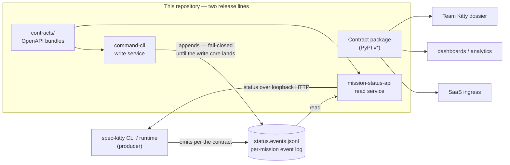

<p align="center"></p>

# spec-kitty-events

**Package Version**: `11.3.0` | **Envelope Schema Version**: `3.0.0` | **Python**: `>=3.10`

The **event contracts** of Spec Kitty: the canonical vocabulary the Spec Kitty CLI and
runtime emit as a Mission moves through its lifecycle — **and the home of the events-domain
services** that read and write those events. This repository is the
event-contract surface of the [Build Kitty](https://github.com/spec-kitty/spec-kitty)
product line — the free CLI and its extension surface.

`spec-kitty-events` owns the CloudEvents-shaped **envelope**, the **payload schemas** for
every event family, the pure **reducers** that fold an event stream into state, the packaged
**conformance fixtures**, and the **compatibility policy**. It is a small, dependency-light
Python package with no runtime dependency on the CLI, so any system — a dashboard, an
analytics job, the Team Kitty dossier, a SaaS ingress — can validate, order and reduce
Spec Kitty events **orthogonally**, without coupling to the CLI's internals.



## What this package gives you

- **One envelope.** `Event` is the single top-level envelope every family rides in: a
  stable set of context fields (identity, ordering clock, project, schema version) carrying
  an opaque, per-family `payload`.
- **Event families.** Typed Pydantic payload models and event-type constants for mission
  lifecycle, work-package status, review and audit, runtime observation, collaboration, and
  semantics and analytics. See [Event families](docs/events/README.md).
- **Deterministic reducers.** Pure functions that fold an ordered event stream into a frozen
  state snapshot (mission state, work-package lanes, audit verdict, collaboration roster, …).
- **A fail-closed strict profile.** `validate_strict_envelope` — an opt-in, deterministic
  gate (`STRICT_PROFILE_ID = "journal/v1"`) for the durable journal and TeamSpace ingress.
- **Conformance fixtures.** Valid/invalid payloads, replay streams and golden reducer
  outputs, shipped in the package so every consumer validates against one corpus.

## Documentation

The documentation site follows the [doc-kitty](https://github.com/spec-kitty/doc-kitty)
convention and is published from `main` to
<https://spec-kitty.github.io/spec-kitty-events/>. Start at
[`docs/README.md`](docs/README.md):

- [Context](docs/context/README.md) — what the package is and how it is produced and consumed.
- [Event families](docs/events/README.md) — the families grouped by concern.
- [API & Contracts](docs/api/README.md) — the envelope, the Python package, the lane
  vocabulary, the versioning policy and the strict profile.
- [Service APIs](docs/api/services.md) — the read and write services and their `service-v*`
  release line.
- [Architecture](docs/architecture/README.md) — the envelope design, ordering and
  reduction, the journal-versus-volatile durability split, and the services.
- [Glossary](docs/glossary/README.md) · [Decision Records](docs/adr/README.md) ·
  [Guides](docs/guides/README.md) · [Changelog](docs/changelog/README.md)

The durable, governing contracts live in [`contracts/`](contracts/README.md);
[`COMPATIBILITY.md`](COMPATIBILITY.md) is the public compatibility policy and the
authoritative version-and-compatibility reference.

## Services

Two **events-domain services** (Java, under [`service/`](service/README.md)) live here and
ship on their own `service-v*` release line, versioned and released apart from the package
([ADR 0003](docs/adr/0003-gradle-build-and-service-release-line.md),
[ADR 0004](docs/adr/0004-dual-artifact-line.md)). Both are loopback-only: they bind
`127.0.0.1` and answer to no other address.

- **Read: `mission-status-api`** — a detached, read-only HTTP service that reads the
  Missions of one project directory and serves their status (`GET /api/v1/project`,
  `GET /api/v1/missions`, the `GET /api/v1/events` change stream and two artifact reads).
  No spec-kitty command starts it; run it yourself:

  ```bash
  java -jar build/libs/mission-status-api.jar --mission-status.project-root=<project root> --mission-status.port=8787
  ```

  How to run it from a release or from source:
  [Running the Mission Status Read API](https://spec-kitty.github.io/spec-kitty-events/guides/running-the-service/);
  details in [`service/README.md`](service/README.md).

- **Write: `command-cli`** — the canonical event writer the CLI's launcher starts, checks
  ready and drives per git common dir; it publishes its port and bearer token in
  `endpoint.json` for the launcher alone. Until the write core lands
  ([#160](https://github.com/spec-kitty/spec-kitty-events/issues/160),
  [#161](https://github.com/spec-kitty/spec-kitty-events/issues/161)) every write **refuses
  fail-closed**. From a checkout:

  ```bash
  java -jar build/libs/command-cli.jar serve --git-common-dir <absolute git common dir>
  ```

  Details in [`service/command-cli/README.md`](service/command-cli/README.md) and the
  [write-service protocol](https://spec-kitty.github.io/spec-kitty-events/architecture/services/write-service-protocol/).

## Contracts and API reference

The normative contracts for both services live under `contracts/`
([`contracts/mission-status`](contracts/mission-status),
[`contracts/mission-write`](contracts/mission-write)); `contracts/tools/bundle.py` resolves
each module to a single self-contained OpenAPI file, and the docs site renders them with the
raw bundle and its sha256 alongside:

- [mission-status API reference](https://spec-kitty.github.io/spec-kitty-events/reference/api/mission-status/) — the read service's endpoints.
- [mission-write API reference](https://spec-kitty.github.io/spec-kitty-events/reference/api/mission-write/) — the write service's endpoints.
- [Service APIs](https://spec-kitty.github.io/spec-kitty-events/api/services/) — the hub for both.
- [Event envelope schema](https://spec-kitty.github.io/spec-kitty-events/api/envelope/event-envelope/) — the normative envelope the Python payloads ride in.

## Installation

Pin a **released version** (a `v<version>` tag), not a mainline commit — a package version
is frozen only when it is tagged, so `main` may still move an unreleased version
([versioning policy](contracts/versioning-and-compatibility.md)).

From PyPI (pin an explicit version — see [`COMPATIBILITY.md`](COMPATIBILITY.md) for the
current release and what a major bump means):

```bash
pip install "spec-kitty-events==11.3.0"
# with conformance-validation support:
pip install "spec-kitty-events[conformance]==11.3.0"
```

With [uv](https://docs.astral.sh/uv/), install the exact versions pinned by the committed
`uv.lock` — what CI and `make test-fast` / `make test-full` resolve against:

```bash
uv sync --locked --extra dev --extra conformance
```

## Quick start

### Emit a canonical envelope

```python
import uuid
from datetime import datetime, timezone

from spec_kitty_events import Event

event = Event(
    event_id="01ARZ3NDEKTSV4RRFFQ69G5FAV",
    event_type="WPStatusChanged",
    aggregate_id="mission/WP01",
    payload={
        "mission_slug": "mission-001",
        "wp_id": "WP01",
        "from_lane": "planned",
        "to_lane": "claimed",
        "actor": "ci-bot",
        "execution_mode": "worktree",
    },
    timestamp=datetime.now(timezone.utc),
    build_id="build-2026-04-05",
    node_id="runner-01",
    lamport_clock=1,
    project_uuid=uuid.uuid4(),
    correlation_id="01ARZ3NDEKTSV4RRFFQ69G5FAV",
    schema_version="3.0.0",
)
```

### Validate a payload against the canonical contract

```python
from spec_kitty_events.conformance import validate_event

result = validate_event(event.payload, "WPStatusChanged")
assert result.valid
```

### Gate a full envelope fail-closed (durable journal / ingress)

```python
from spec_kitty_events.strict import validate_strict_envelope

errors = validate_strict_envelope(event.to_dict())
assert not errors
```

More, including reducing a stream into state, is in
[API & Contracts](docs/api/README.md).

## Versioning: two release lines

The repository releases on **two independent lines**:

- The **package line** — `v*` tags on PyPI — carries the Python contract package (current
  version at the top of this file). Two version numbers move independently on it: the
  **package version** (contract behaviour) and the on-wire envelope `schema_version`
  (`3.0.0`, held stable across package majors).
- The **service line** — `service-v*` tags, current release `service-v0.1.0-rc.2` — ships
  the events-domain services as attested native binaries and JVM jars with the contract
  bundles attached. See
  [service protocol and releases](docs/guides/service-protocol-and-releases.md).

A change is major if it flips the accept/reject boundary for any producer or consumer. The
rules and the required artifacts on a bump are in
[`contracts/versioning-and-compatibility.md`](contracts/versioning-and-compatibility.md).

## Development

```bash
make test-fast     # implementer blast-radius baseline
make test-full     # whole suite with coverage (CI agent)
uv run pytest --pyargs spec_kitty_events.conformance   # packaged conformance gate — every PR
ruff check . && ruff format --check .                  # lint
make test-java     # the Java binding check alone (JDK 25, provisioned if absent)
make test-gradle   # the whole Gradle build — ./gradlew verifyAll over the binding, the services and the contracts
```

The Gradle build is `./gradlew verifyAll` (run through [`scripts/verify_all.sh`](scripts/verify_all.sh),
which stages the contract bundle); it needs JDK 25, which
[`scripts/ensure_jdk25.sh`](scripts/ensure_jdk25.sh) finds or provisions.

See [`AGENTS.md`](AGENTS.md) for the programme process and
[`docs/guides/contributing.md`](docs/guides/contributing.md).

## License

[MIT](LICENSE) © 2026 Spec Kitty, Inc. and contributors.
