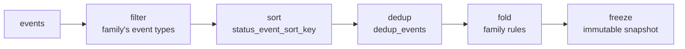

# Ordering and reduction

Reducing an event stream into state has to be **deterministic**: the same events, in any
received order, must fold to the same snapshot. That needs a total order that does not depend
on wall-clock time, and a fold that is pure. This page describes both.

## Ordering by Lamport clock, not time

The envelope's `timestamp` is the producer's wall-clock occurrence time. It can skew between
nodes, so it is **never** used to order a stream. Ordering is owned by
`(lamport_clock, node_id)`: the Lamport logical clock establishes causal order and `node_id`
breaks ties deterministically. Consumers preserve `timestamp` for display and record receipt
time separately; they never substitute it for ordering.

`spec_kitty_events.conflict` carries the legacy key `total_order_key(event) -> (lamport_clock,
node_id)` over the Pydantic `Event`, and `is_concurrent(e1, e2)` for detecting concurrency.

## The total order over rows

For rows in CloudEvents (upcast) form, `spec_kitty_events.total_order` defines a lexicographic
key that is total by construction:

```
key(r) = ( h(r), c(r), t(r), i(r), s(r) )
```

| Part | Value |
|---|---|
| `h` | `1` if the row has a `lamportclock`, else `0` — every clockless row sorts before every clocked one |
| `c` | the `lamportclock`, else `0` |
| `t` | `time` as an exact UTC instant |
| `i` | `id`, normalised (ULID upper-cased, UUID lower-cased and hyphenated) |
| `s` | `source`, empty string when absent |

Keys compare left to right, ascending; strings compare by Unicode code point. This replaces
the naive "clock if both have one, else time" rule, which is **not transitive** and would
make a sort order depend on input order. A clock outside the CloudEvents `Integer` range
(`0..2^31-1`), or a `null` clock, makes an **error row** (`clock_out_of_range`) rather than a
clockless one. `order_rows` returns an `OrderResult`; this order is proposed under
[ADR-0001](/adr/0001-cloudevents-envelope/) and no reducer uses it yet.

## The reducer pipeline

Every family reducer is a pure function sharing one pipeline:



1. **Filter** to the family's event types.
2. **Sort** by the deterministic key (`status.status_event_sort_key`).
3. **De-duplicate** (`status.dedup_events`) so a replayed or re-delivered event folds once.
4. **Fold** by the family's own rules.
5. **Freeze** into an immutable reduced-state object.

The fold is pure — no clocks read, no I/O — so a replay of the same stream always yields the
same snapshot. That is what lets the Team Kitty dossier run the very reducer the CLI runs and
agree by construction. See [work & status](/events/work-and-status/) for the status reducer
and [the Python package](/api/python-package/) for the full reducer list.

## Anomalies, not exceptions

A reducer records what it could not reconcile — an out-of-order transition, an authority
violation, a late event after a terminal state — as a typed **anomaly** on the reduced state
(for example `TransitionAnomaly`, `LifecycleAnomaly`), rather than throwing. The snapshot
stays usable and the anomalies are inspectable, so a consumer sees both the best-effort state
and what was wrong with the stream.
