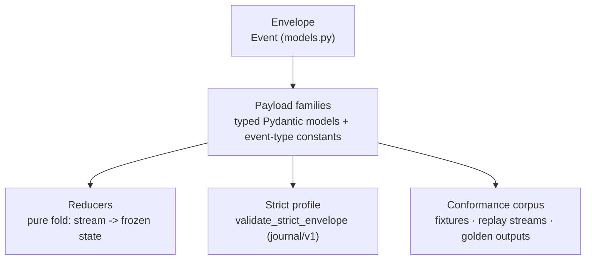
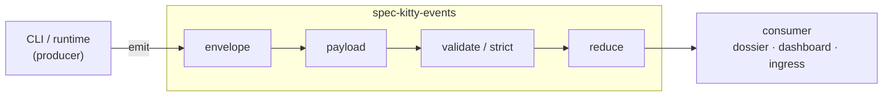

# Overview

`spec-kitty-events` is a contract package, not a service. It has five parts, and everything
else builds on them. Read this page first, then the page for the part you care about.

## The five parts

1. **The envelope.** `Event` is the single top-level envelope every family rides in — stable
   context fields carrying an opaque `payload`. See [the envelope](/api/envelope/).
2. **Payload families.** One module per family defines its typed payload models and its
   event-type string constants. See [Event families](/events/).
3. **Reducers.** Pure, deterministic functions that fold an ordered stream into a frozen
   state snapshot. They all share one pipeline — see
   [ordering and reduction](/architecture/ordering-and-reduction/).
4. **The strict profile.** The opt-in, fail-closed envelope gate for the durable journal and
   ingress. See [the strict profile](/api/strict-profile/).
5. **The conformance corpus.** Valid/invalid payloads, replay streams and golden reducer
   outputs, shipped in the package so every consumer validates against one corpus.

## The producer-consumer flow

The Spec Kitty CLI and runtime are the single producer; everything else is a consumer. The
contract is the only coupling between them.

A producer builds an `Event`, fills the family payload, and emits it on one of three
[transports](/context/system-context/). A consumer validates the payload (`validate_event`),
optionally gates the envelope fail-closed (`validate_strict_envelope`), and folds the stream
with the family reducer. Because the contract carries no behaviour, consumers stay
[orthogonal](/context/) to the CLI.

## What this package deliberately does not own

- **No team routing.** Identity on the envelope is build-scoped (`build_id`, `node_id`);
  private-versus-team routing, sharing and approval are host-product policy.
- **No transport or network.** The package defines shapes and folds; producing and shipping
  events is the CLI's and the host's job.
- **No single current-version restatement.** The authoritative version lives once in
  `COMPATIBILITY.md`; see [versioning & compatibility](/api/versioning-and-compatibility/).

## See also

- [Ordering and reduction](/architecture/ordering-and-reduction/) — how a stream becomes
  deterministic state.
- [Durability and the relay](/architecture/durability-and-relay/) — which events are durable
  and which are volatile.
