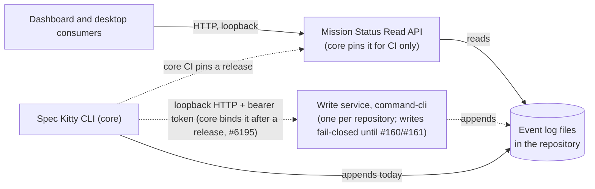
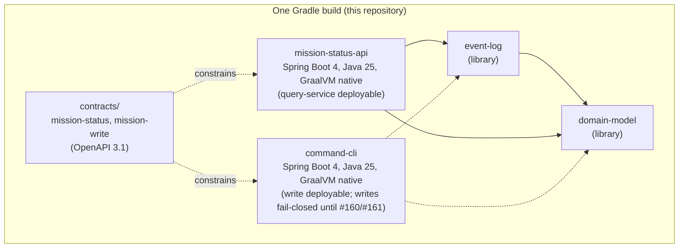
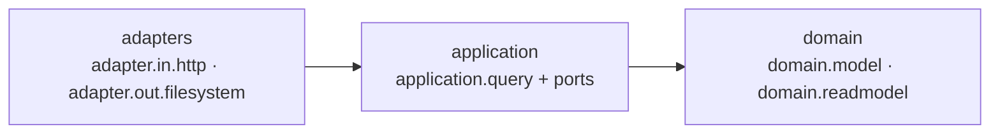

# Services overview

> **Where this code lives.** The code described here lives in this repository, under
> [`service/`](https://github.com/spec-kitty/spec-kitty-events/tree/main/service) and
> [`contracts/`](https://github.com/spec-kitty/spec-kitty-events/tree/main/contracts),
> imported from core at `512567eee71e31bb39f580c4f7acf8b865e9d1b2` with its history
> ([ADR-0002](../../adr/0002-events-domain-owns-its-services.md)). Citations of those files
> point here; citations of what stays in core (its ADRs, the CLI, the Python appenders) point
> at core at `4eecb124`, where they were checked.
> Core's counterpart record is ADR 2026-10-29-1,
> [the events domain and its Java services live in spec-kitty-events](https://github.com/spec-kitty/spec-kitty/blob/main/docs/adr/4.x/2026-10-29-1-the-events-domain-and-its-java-services-live-in-spec-kitty-events.md)
> (accepted in core PR spec-kitty/spec-kitty#6782; the link resolves once that PR merges into
> core `main`).

The events domain has two services, one per side of a CQRS split
([read-write split](./read-write-split.md)):

- **The Mission Status Read API** (`mission-status-api`) exists. It is a read-only,
  loopback-only HTTP service
  ([`service/README.md`](https://github.com/spec-kitty/spec-kitty-events/blob/main/service/README.md)).
- **The write service** (`command-cli`) is **built and runnable, and its writes refuse
  fail-closed**
  ([`service/command-cli/README.md`](https://github.com/spec-kitty/spec-kitty-events/blob/main/service/command-cli/README.md),
  #156).
  - It implements the launcher contract and the protocol surface of
    [`contracts/mission-write`](https://github.com/spec-kitty/spec-kitty-events/tree/main/contracts/mission-write)
    (#6675).
  - The canonical writer (#160) and the lane authority (#161) come next. The lock and
    torn-tail parts of the `event-log` library (#6193) are what the writer will use. See
  [event-log lock and append](./event-log-lock-and-append.md) and the
  [write-service protocol](./write-service-protocol.md).

## C4 level 1: context

- **Read API.** Its consumers are external UIs: the dashboard in `spec-kitty-mission-ui` and
  Kitty Desktop (core
  [ADR 2026-10-01-2](https://github.com/spec-kitty/spec-kitty/blob/4eecb12414dac53432f4af21ba958d199d5ce808/docs/adr/4.x/2026-10-01-2-mission-status-read-api-and-dashboard-extraction.md),
  Amendment 2026-10-03). No spec-kitty command starts it, and it is not in the PyPI wheel
  (README, first paragraph). Core pins its release for CI only
  ([ADR-0002](../../adr/0002-events-domain-owns-its-services.md), decision 3).
- **Write service.** One resident service per repository, keyed on the git common dir,
  reached through the CLI's EventBridge port (core
  [ADR 2026-10-22-1](https://github.com/spec-kitty/spec-kitty/blob/4eecb12414dac53432f4af21ba958d199d5ce808/docs/adr/4.x/2026-10-22-1-the-java-write-service-is-the-canonical-event-writer.md)
  D-2, D-3).
- **Today the CLI still appends** to every event log itself
  ([event ledger writers and readers](./event-ledger-writers-and-readers.md),
  "Current state: writers").

Core's own C4 pages
([`docs/architecture/diagrams/01_context`](https://github.com/spec-kitty/spec-kitty/blob/4eecb12414dac53432f4af21ba958d199d5ce808/docs/architecture/diagrams/01_context/README.md),
[`02_containers`](https://github.com/spec-kitty/spec-kitty/blob/4eecb12414dac53432f4af21ba958d199d5ce808/docs/architecture/diagrams/02_containers/README.md))
still say `services/mission-status-api/` "does not exist yet". That is stale: the service
ships. The diagrams on this page follow the code.

## C4 level 2: containers

| Container | What it is | Evidence |
|---|---|---|
| `mission-status-api` | The root Gradle project in core (`:mission-status-api` in `service/` here): the `query-service` deployable. Spring Boot 4 (Spring MVC on virtual threads), Java 25, a GraalVM native binary for four targets plus a JVM jar. | README, "Package layout" and "Release and binaries"; core ADR 2026-10-01-2 Amendment 2026-10-03 (D-4) |
| `domain-model` | The Mission status types (Mission, work package, lane, status event, snapshot). No declared dependency, no `java.io` or `java.nio.file`. | README, "Package layout"; `DomainModelBoundaryTest` |
| `event-log` | The line codec, the event ordering and `StatusReducer`, and the ledger file mechanics (`LedgerLocks`, `TornTailRepair`). Depends on `domain-model` and the Jackson streaming parser only. | README, "Package layout"; `EventLogBoundaryTest` |
| contracts | `contracts/mission-status/openapi.yaml` (read) and `contracts/mission-write/openapi.yaml` (write), both `1.0.0-SNAPSHOT`. | [`contracts/mission-write/CHANGELOG.md`](https://github.com/spec-kitty/spec-kitty-events/blob/main/contracts/mission-write/CHANGELOG.md); writers-and-readers page, "The read API contract" |
| `command-cli` | The write-service deployable named by #6117 decision 12 (`service/command-cli`, #156): Spring Boot 4, Java 25, a GraalVM native binary for four targets plus a JVM jar. It implements the launcher contract and the protocol surface; every write refuses fail-closed until #160 and #161 land. | [`service/command-cli/README.md`](https://github.com/spec-kitty/spec-kitty-events/blob/main/service/command-cli/README.md); core ADR 2026-10-22-1 D-1 |

The four module names are #6117 decision 12's: `domain-model`, `event-log`, `query-service`
and `command-cli` (core ADR 2026-10-22-1 D-1). The read service and the write service share
`domain-model`; the read service stays read-only and separate (D-8).

## Onion layering

Dependencies point inward only. The domain is pure, the application holds the query
services and their ports, and the adapters hold HTTP in and the file system out. The
read service's package layout:

- `domain.model` (the `domain-model` library), `domain.readmodel` and `domain.redaction`.
- `application.query` (`MissionStatusQueryService`, `ProjectionCache`, `stream`), with
  `application.query.port.in` and `application.query.port.out` holding interfaces only.
  `application.command` is reserved and empty.
- `adapter.in.http`, `adapter.out.filesystem` (with its `codec`), and `config`.

### The rules, and the tests that enforce them

[`ArchitectureRulesTest`](https://github.com/spec-kitty/spec-kitty-events/blob/main/service/src/test/java/org/speckitty/missionstatus/architecture/ArchitectureRulesTest.java)
runs the fourteen rules defined in
[`ArchitectureRules`](https://github.com/spec-kitty/spec-kitty-events/blob/main/service/src/test/java/org/speckitty/missionstatus/architecture/ArchitectureRules.java).
It also fails when the number of rules run differs from the number defined, and every rule
has a positive control in `ArchitectureControlsTest`. The rule texts, shortened:

1. The domain is free of frameworks, JSON, file APIs and concurrency, and creates no thread.
2. The application depends only on itself, the domain and the JDK, and creates no thread
   (the executor is injected).
3. `adapter.in.http` reaches, among project packages, only `application.query.port.in`, the
   domain and itself.
4. `adapter.out.filesystem` reaches only `application.query.port.out`, the domain and itself.
5. No adapter depends on an adapter of the other direction.
6. Nothing outside `config` depends on `config`.
7. File APIs are used only in `adapter.out.filesystem` (not its codec) and in `event-log`'s
   `adapter.out.ledger`.
8. JSON libraries and Spring are used only in adapters and `config`.
9. Contract DTO packages are used only in `adapter.in.http`.
10. No `ProcessBuilder` and no `Runtime.exec`.
11. The port-level conformance subset is source-neutral (a test-scope rule).
12. The codec is pure decoding: no file API, used only by `adapter.out.filesystem` and test
    support.
13. A class directly in a query port package is an interface.
14. Nothing in `application.query` depends on `application.command`.

The two libraries carry their own boundary tests, because they build on their own:

- [`DomainModelBoundaryTest`](https://github.com/spec-kitty/spec-kitty-events/blob/main/service/domain-model/src/test/java/org/speckitty/missionstatus/architecture/DomainModelBoundaryTest.java):
  `domain-model` depends only on itself and the rule 1b JDK packages, and all 18 types it
  held at extraction (#6192) are still checked.
- [`EventLogBoundaryTest`](https://github.com/spec-kitty/spec-kitty-events/blob/main/service/event-log/src/test/java/org/speckitty/missionstatus/architecture/EventLogBoundaryTest.java):
  the codec depends only on itself, `domain-model`, the Jackson streaming parser and the
  JDK; the reducer has no parser, codec or I/O; the ledger package uses the JDK alone; and
  the module holds those three packages and no other.

## Where it lives

| In core until the import (`4eecb124`) | Since the import, in this repository |
|---|---|
| `services/mission-status-api/` (with `domain-model/` and `event-log/`) | `service/` |
| `contracts/mission-status/`, `contracts/mission-write/`, `_shared`, `tools`, `lint` | `contracts/` |
| CLI client shapes `src/specify_cli/status/write_service_protocol.py`, the EventBridge, the launcher | stay in core |

The import kept git history (`git filter-repo` from the frozen core SHA `512567eee71e31bb39f580c4f7acf8b865e9d1b2`) and ran on
the operator's go-signal ([ADR-0002](../../adr/0002-events-domain-owns-its-services.md),
decision 2). The build and release line are in
[ADR-0003](../../adr/0003-gradle-build-and-service-release-line.md).
