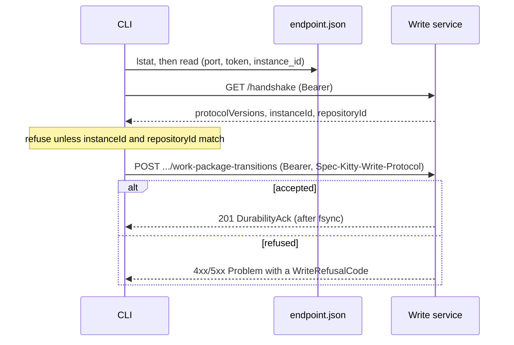

# Write-service protocol

> **Where this code lives.** The contract described here lives in this repository, under
> [`contracts/mission-write`](https://github.com/spec-kitty/spec-kitty-events/tree/main/contracts/mission-write),
> imported from core at `512567eee71e31bb39f580c4f7acf8b865e9d1b2` with its history
> ([ADR-0002](../../adr/0002-events-domain-owns-its-services.md)). Citations of contract files
> point here; citations of what stays in core (its ADRs, the CLI client) point at core at
> `4eecb124`.
>
> **The write service is not built yet.** This page describes its contract,
> [`contracts/mission-write`](https://github.com/spec-kitty/spec-kitty-events/tree/main/contracts/mission-write)
> (`1.0.0-SNAPSHOT`, #6675), and the record that decides it, core
> [ADR 2026-10-27-1](https://github.com/spec-kitty/spec-kitty/blob/4eecb12414dac53432f4af21ba958d199d5ce808/docs/adr/4.x/2026-10-27-1-the-write-service-protocol-is-loopback-http-with-a-bearer-token.md).
> The client shapes are in core's `src/specify_cli/status/write_service_protocol.py`, which
> has no transport yet (D-8).

## Transport

- **Loopback HTTP** (D-1). The service binds `127.0.0.1` only, on a port the OS picks, never
  `localhost`, `0.0.0.0` or IPv6. The contract is served under `/api/v1`.
- **The read service's guard applies:** `Host` must be `127.0.0.1:<port>`, an `Origin` must
  name the same, and `Sec-Fetch-Site: cross-site` is refused, all with `403 REQUEST_REFUSED`.

## The endpoint file and the token

The service publishes `<git-common-dir>/spec-kitty-write-service/endpoint.json` (D-2). Every
worktree of a clone resolves the same git common dir, so all reach one service.

- **Fields:** `schema_version` (1), `host` (`127.0.0.1`), `port`, `token`, `instance_id` (a
  ULID minted at each start), `pid` (diagnostics only), `protocol_versions` (informative),
  `started_at`.
- **Token:** 32 random bytes, URL-safe base64 without padding, new at every start, sent as
  `Authorization: Bearer <token>` on every request (the contract's `writeToken` scheme). It
  is never logged or echoed.
- **Permissions:** on POSIX the directory is `0700` and the file `0600`. The client refuses a
  file with any group or other bit, a link, a non-regular file, another owner or a
  non-loopback host (`WRITE_SERVICE_ENDPOINT_EXPOSED`, `..._NOT_LOOPBACK`, `..._MALFORMED`,
  `..._MISSING`). On Windows the service sets an owner-only ACL.

## Handshake and version negotiation

`GET /handshake` and `GET /health` need the bearer token but no protocol header (D-4;
[`paths/handshake.yaml`](https://github.com/spec-kitty/spec-kitty-events/blob/main/contracts/mission-write/paths/handshake.yaml),
[`paths/health.yaml`](https://github.com/spec-kitty/spec-kitty-events/blob/main/contracts/mission-write/paths/health.yaml)).

The handshake
([`schemas/Handshake.yaml`](https://github.com/spec-kitty/spec-kitty-events/blob/main/contracts/mission-write/schemas/Handshake.yaml))
returns `protocolVersions`, `serviceVersion`, `instanceId` and `repositoryId`. The client:

1. requires `instanceId` to equal the endpoint file's `instance_id`;
2. requires `repositoryId` to equal its own digest: the lowercase hex SHA-256 of the git
   common dir's real path in forward-slash form;
3. sends the highest major both sides speak in the `Spec-Kitty-Write-Protocol` header on
   every other request. A missing, non-integer or unsupported value is
   `400 PROTOCOL_VERSION_UNSUPPORTED`.

The CLI speaks major 1 today (`SUPPORTED_PROTOCOL_VERSIONS = (1,)` in
`write_service_protocol.py`). A major changes only with a breaking contract change.

## Durability-acked writes

A unit is appended in one `O_APPEND` write of full JSON lines and synced before the `201`;
a batch is one write and one `fsync`, all or nothing (D-5). A batch holds at most 64 units;
more is `400 REQUEST_MALFORMED` (open question 7, provisional, and the `REQUEST_MALFORMED`
description in
[`schemas/WriteRefusalCode.yaml`](https://github.com/spec-kitty/spec-kitty-events/blob/main/contracts/mission-write/schemas/WriteRefusalCode.yaml)).
The answer is a
[`DurabilityAck`](https://github.com/spec-kitty/spec-kitty-events/blob/main/contracts/mission-write/schemas/DurabilityAck.yaml):
`eventIds`, `appendedLines`, `fsynced` (always `true`), `statusCommit` (`null` until the status
commit joins the unit at migration step 4) and `replayed`. A retry whose rows are all
persisted with identical content answers `replayed: true` with `appendedLines: 0`
(provisional, open question 1). See [event-log lock and append](./event-log-lock-and-append.md).

## Refusals

Every refusal is a `Problem` with a `code` from
[`schemas/WriteRefusalCode.yaml`](https://github.com/spec-kitty/spec-kitty-events/blob/main/contracts/mission-write/schemas/WriteRefusalCode.yaml)
(D-6). The service is authoritative: a CLI pre-check may shape a message but never replaces
the service's check (D-3).

- **29 codes.** 20 are the CLI's codes verbatim (for example `TRANSITION_REJECTED`,
  `WP_ALREADY_CLAIMED`, `DEPENDENCIES_NOT_SATISFIED`, `STATUS_LOCK_HELD`,
  `PROTECTED_BRANCH_REFUSED`), so moving a write into the service changes no code a user
  sees. 9 are protocol-only: `REQUEST_MALFORMED`, `PROTOCOL_VERSION_UNSUPPORTED`,
  `WRITE_TOKEN_INVALID`, `REQUEST_REFUSED`, `WRITE_LOCATION_UNVERIFIED`, `EVENT_ID_CONFLICT`,
  `REQUEST_TOO_LARGE`, `SERVICE_BUSY` and `SERVICE_DRAINING`.
- **Order of checks:** the Host and Origin guard (403), the bearer token (401), the protocol
  header (400), the size cap (413), the body's shape (400), then the domain (404, 409, 422).
- **Parity** with the CLI is held by `tests/contract/fixtures/mission_write_refusal_parity.yaml`,
  which a test checks against each cited CLI source file.

## Operations

From
[`openapi.yaml`](https://github.com/spec-kitty/spec-kitty-events/blob/main/contracts/mission-write/openapi.yaml),
all under `/api/v1` and all requiring the bearer token:

| operationId | Method and path | Protocol header |
|---|---|---|
| `handshake` | `GET /handshake` | no |
| `getHealth` | `GET /health` | no |
| `recordWorkPackageTransition` | `POST /missions/{missionId}/work-package-transitions` | yes |
| `recordWorkPackageTransitionBatch` | `POST /missions/{missionId}/work-package-transitions/batch` | yes |
| `recordInnerStateAnnotation` | `POST /missions/{missionId}/inner-state-annotations` | yes |
| `shutdown` | `POST /shutdown` | yes |

## One write, end to end

## Process lifecycle (launcher contract)

**Agreed 2026-10-29; recorded in the contract at cutover; `/shutdown` provisional until
`command-cli` is built.** The operator accepted this contract between core's launcher (#6676)
and the write service on 2026-10-29. It is now recorded in the contract as
[`contracts/mission-write/LAUNCHER.md`](https://github.com/spec-kitty/spec-kitty-events/blob/main/contracts/mission-write/LAUNCHER.md), which
is the normative text; the summary below follows it. Parts of it already stood in core
ADR 2026-10-27-1 (D-2, open question 6) and the OpenAPI document.

- **Start.** The launcher runs
  `<binary> serve --git-common-dir <absolute path> [--idle-timeout <seconds>]`. There is one
  write service per git common dir. Without `--idle-timeout`, the service's default applies.
- **Single instance.** The service takes `<gcd>/spec-kitty-write-service/service.lock` and
  publishes `endpoint.json` by writing a temporary file and renaming it into place (D-2). If
  the lock is held, it exits 0 without publishing. Its log file is
  `<gcd>/spec-kitty-write-service/service.log`.
- **Ready** means all three:
  1. `endpoint.json` is present;
  2. `GET /handshake` (bearer) returns a `repositoryId` equal to the SHA-256 of the real path
     of the git common dir, and `protocolVersions` that intersect the CLI's;
  3. `GET /health` returns `status: ready`
     ([`schemas/HealthStatus.yaml`](https://github.com/spec-kitty/spec-kitty-events/blob/main/contracts/mission-write/schemas/HealthStatus.yaml):
     `ready` or `draining`).
- **Stop.** `POST /shutdown` (bearer) drains and exits: health reads `draining`, the service
  finishes the writes it holds, removes its endpoint file and answers `202` before it exits
  ([`paths/shutdown.yaml`](https://github.com/spec-kitty/spec-kitty-events/blob/main/contracts/mission-write/paths/shutdown.yaml)).
  As written, the contract also requires the `Spec-Kitty-Write-Protocol` header on this
  operation and marks it `x-provisional`. If the process is still running after 10 s and its
  pid still matches the endpoint's instance, the launcher falls back to `SIGTERM`
  (`TerminateProcess` on Windows).
