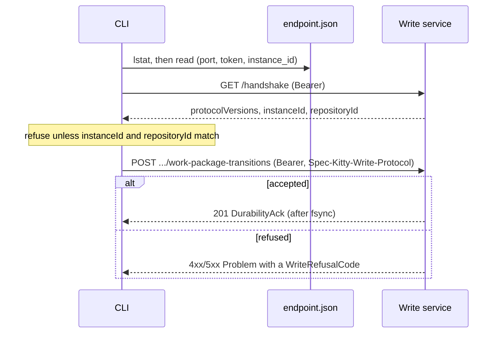

# Write-service protocol

> **Where this code lives.** The contract described here lives in this repository, under
> [`contracts/mission-write`](https://github.com/spec-kitty/spec-kitty-events/tree/main/contracts/mission-write),
> imported from core at `512567eee71e31bb39f580c4f7acf8b865e9d1b2` with its history
> ([ADR-0002](../../adr/0002-events-domain-owns-its-services.md)). Citations of contract files
> point here; citations of what stays in core (its ADRs, the CLI client) point at core at
> `4eecb124`.
>
> **The write service is built and runnable, and its write core serves `checkout_append`.**
> [`service/command-cli`](https://github.com/spec-kitty/spec-kitty-events/tree/main/service/command-cli)
> implements the process contract, the protocol surface and the write core (#160, #161): the
> durable status appender, the lane authority and the typed write edge. A write that passes every
> check is appended and synced, or replayed, and answered `201`. `coordination_ref_commit` is
> refused until migration step 4, so `statusCommit` is null in every acknowledgement.
> This page describes its contract,
> [`contracts/mission-write`](https://github.com/spec-kitty/spec-kitty-events/tree/main/contracts/mission-write)
> (`1.0.1-SNAPSHOT`, #6675; the coordination write by ref,
> [ADR-0007](../../adr/0007-write-service-commits-coordination-status-by-ref.md)), and the record that decides it, core
> [ADR 2026-10-27-1](https://github.com/spec-kitty/spec-kitty/blob/4eecb12414dac53432f4af21ba958d199d5ce808/docs/adr/4.x/2026-10-27-1-the-write-service-protocol-is-loopback-http-with-a-bearer-token.md).
> The client shapes are in core's `src/specify_cli/status/write_service_protocol.py`, and core's
> binding (#6195) lands when a `service-v*` release carries this write core (D-8).

## Transport

- **Loopback HTTP** (D-1). The service binds `127.0.0.1` only, on a port the OS picks, never
  `localhost`, `0.0.0.0` or IPv6. The contract is served under `/api/v1`.
- **The read service's guard applies:** `Host` must be `127.0.0.1:<port>` or
  `localhost:<port>` (the raw header, compared exactly), a request with a `Forwarded` or
  `X-Forwarded-Host` header is refused, an `Origin` must be `http://` plus one of the two
  accepted host forms, and `Sec-Fetch-Site: cross-site` is refused, all with
  `403 REQUEST_REFUSED`.

## The endpoint file and the token

The service publishes `<git-common-dir>/spec-kitty-write-service/endpoint.json` (D-2). Every
worktree of a clone resolves the same git common dir, so all reach one service.

- **Fields:** `schema_version` (1), `host` (`127.0.0.1`), `port`, `token`, `instance_id` (a
  ULID minted at each start), `pid` (diagnostics only), `protocol_versions` (informative),
  `started_at`.
- **Token:** 32 random bytes, URL-safe base64 without padding, new at every start, sent as
  `Authorization: Bearer <token>` on every request (the contract's `writeToken` scheme). It
  is never logged or echoed.
- **Permissions:** on POSIX the directory is `0700` and the file `0600`. The client refuses a
  file with any group or other bit, a link, a non-regular file, another owner or a
  non-loopback host (`WRITE_SERVICE_ENDPOINT_EXPOSED`, `..._NOT_LOOPBACK`, `..._MALFORMED`,
  `..._MISSING`). On Windows the service sets an owner-only ACL.

## Handshake and version negotiation

`GET /handshake` and `GET /health` need the bearer token but no protocol header (D-4;
[`paths/handshake.yaml`](https://github.com/spec-kitty/spec-kitty-events/blob/main/contracts/mission-write/paths/handshake.yaml),
[`paths/health.yaml`](https://github.com/spec-kitty/spec-kitty-events/blob/main/contracts/mission-write/paths/health.yaml)).

The handshake
([`schemas/Handshake.yaml`](https://github.com/spec-kitty/spec-kitty-events/blob/main/contracts/mission-write/schemas/Handshake.yaml))
returns `protocolVersions`, `serviceVersion`, `instanceId` and `repositoryId`. The client:

1. requires `instanceId` to equal the endpoint file's `instance_id`;
2. requires `repositoryId` to equal its own digest: the lowercase hex SHA-256 of the git
   common dir's real path in forward-slash form;
3. sends the highest major both sides speak in the `Spec-Kitty-Write-Protocol` header on
   every other request. A missing, non-integer or unsupported value is
   `400 PROTOCOL_VERSION_UNSUPPORTED`.

The CLI speaks major 1 today (`SUPPORTED_PROTOCOL_VERSIONS = (1,)` in
`write_service_protocol.py`). A major changes only with a breaking contract change.

## What a write does

Three operations write the Mission's `status.events.jsonl`: one unit
(`TransitionUnit`), a batch of 1 to 64 units (`TransitionBatch`) and one standalone annotation
(`AnnotationRequest`). A unit's first row is the transition and later rows are its annotations. A
unit carries an optional `operation` — `transition` (also the default when absent),
`start_implementation` or `start_review` — and the last two run core's lifecycle claim rules. A
batch's units must share `missionDirectory`, `writeSurface` and `destinationRef`, because a batch
is one write (one commit, once `coordination_ref_commit` is served).

`application.write.WriteService` runs the checks in the order of FR-026. The first failure
answers, and nothing before the append is written:

1. **Edge and shape** — the Host/Origin guard, the bearer token, a canonical request target,
   the protocol header, the 1 MiB cap, draining, then the body's schema, its cross-field and row
   rules, and the row codec's check. See [Refusals](#refusals).
2. **Surface** — `coordination_ref_commit` answers `422 WRITE_LOCATION_UNVERIFIED` before any
   Mission lookup (ADR-0007 D-4).
3. **Mission** — a root that cannot be verified is `422 WRITE_LOCATION_UNVERIFIED`; no matching
   `meta.json` is `404 MISSION_NOT_FOUND`.
4. **Location** — `422 WRITE_LOCATION_UNVERIFIED` unless `checkout` is `.`, `destinationRef` is
   null, `missionDirectory` resolves to the Mission's own directory, and the Mission is not
   coordination-routed (a coordination-routed Mission is R16).
5. **Work packages** — `404 WP_NOT_FOUND`.
6. **Duplicate ids** — an `event_id` twice in the request is `409 BOOKKEEPING_DOUBLE_EVENT_ID`.
7. **The turn, then the Mission lock** — one fair in-process turn, then the same per-Mission
   status lock core's Python writer takes, both inside one 10 s deadline.
8. **The log** — a torn tail or a log the fold cannot reduce answers
   `500 STATUS_EVENT_PERSISTENCE_VERIFICATION_FAILED`.
9. **Per unit** — replay, conflict or new, decided by byte equality of the encoded, sanitized
   rows.
10. **The authority** — the lane machine and its guards, dependencies, the claim/start rules and
    the pipeline guards, over the new units in order.
11. **One append and one sync**, then `201`.

### Durability and idempotency

All new rows — one unit or a whole batch — go out in one `O_APPEND` write of complete JSON
lines, then `fsync`; when the log is created its parent directory is synced too. A failed or
short write is rolled back (the log is truncated to its size before the write and forced) and
answers `500`; one lock hold permits one append. Writes are LF-only, and a CR before the LF is
tolerated on read. A log whose last byte is not LF is a torn tail and is refused, never repaired
([#222](https://github.com/spec-kitty/spec-kitty-events/issues/222) is the follow-up repair
command). A log holding a raw U+0085, U+2028, U+2029, VT, FF, FS, GS or RS is unreducible (R24).

A retry whose rows are all present with identical bytes is a replay: `201` with
`replayed: true` and `appendedLines: 0`, writing and syncing nothing. Some ids present and some
absent, or any present row differing in bytes, is `409 EVENT_ID_CONFLICT` (a batch names the
unit). The first occurrence of an id in the log is the one compared. A fully replayed batch
answers `fsyncs: 0`.

### The acknowledgement

A unit answers a [`DurabilityAck`](https://github.com/spec-kitty/spec-kitty-events/blob/main/contracts/mission-write/schemas/DurabilityAck.yaml):
`eventIds`, `appendedLines`, `fsynced` (always `true`), `statusCommit` (`null` until the status
commit joins the unit at migration step 4) and `replayed`. A batch answers a
[`BatchDurabilityAck`](https://github.com/spec-kitty/spec-kitty-events/blob/main/contracts/mission-write/schemas/BatchDurabilityAck.yaml):
`fsyncs` (`1`, or `0` when every unit replayed) and one `DurabilityAck` per unit in request order.
The client contract for the write path is in core's `src/specify_cli/status/write_service_protocol.py`.
See [event-log lock and append](./event-log-lock-and-append.md) for the lock path and the
session that writes the bytes.

## Refusals

Every refusal is a `Problem` with a `code` from
[`schemas/WriteRefusalCode.yaml`](https://github.com/spec-kitty/spec-kitty-events/blob/main/contracts/mission-write/schemas/WriteRefusalCode.yaml)
(D-6). The service is authoritative: a CLI pre-check may shape a message but never replaces
the service's check (D-3).

- **27 codes.** 15 are the CLI's codes verbatim (for example `TRANSITION_REJECTED`,
  `WP_ALREADY_CLAIMED`, `DEPENDENCIES_NOT_SATISFIED`, `STATUS_LOCK_HELD`,
  `PROTECTED_BRANCH_REFUSED`), so moving a `checkout_append` write into the service changes
  no code a user sees; the coordination write changes codes on purpose. 12 are protocol-only: `REQUEST_MALFORMED`, `PROTOCOL_VERSION_UNSUPPORTED`,
  `WRITE_TOKEN_INVALID`, `REQUEST_REFUSED`, `WRITE_LOCATION_UNVERIFIED`, `EVENT_ID_CONFLICT`,
  `REQUEST_TOO_LARGE`, `SERVICE_BUSY`, `SERVICE_DRAINING`, and the three of the coordination
  write by ref, `COORDINATION_REF_MOVED`, `COORDINATION_REF_CHECKED_OUT` and
  `COORDINATION_LEDGER_UNREADABLE` ([ADR-0007](../../adr/0007-write-service-commits-coordination-status-by-ref.md)).
  The five codes that presupposed a coordination worktree were removed in `1.0.1-SNAPSHOT`.

The service that serves `checkout_append` answers 17 of the 27. The ten it does not answer are
the coordination, placement and commit codes of ADR-0007's surface, which migration step 4
serves: `COORDINATION_REF_MOVED`, `COORDINATION_REF_CHECKED_OUT`,
`COORDINATION_LEDGER_UNREADABLE`, `PROTECTED_BRANCH_REFUSED`, `DESTINATION_REF_NOT_FOUND`,
`DESTINATION_REF_INVALID_SHAPE`, `DESTINATION_REF_NOT_LOCAL`, `COORDINATION_BRANCH_DELETED`,
`OWNED_MISSION_PATH_REFUSED` and `BOOKKEEPING_COMMIT_FAILED`.

| Code | Status | When |
|---|---|---|
| `REQUEST_REFUSED` | 403 | the Host/Origin guard |
| `WRITE_TOKEN_INVALID` | 401 | the bearer token (`WWW-Authenticate: Bearer`) |
| `PROTOCOL_VERSION_UNSUPPORTED` | 400 | the protocol header |
| `REQUEST_TOO_LARGE` | 413 | a body over 1 MiB |
| `REQUEST_MALFORMED` | 400 | the shape, a row rule, a non-finite number or a mixed session pair |
| `SERVICE_DRAINING` | 503 | after `/shutdown` or the idle timeout |
| `TRANSITION_REJECTED` | 409 | the lane machine or a guard, with a reason URN |
| `WP_ALREADY_CLAIMED` | 409 | a lifecycle claim held by another actor |
| `DEPENDENCIES_NOT_SATISFIED` | 409 | a gated dependency is not approved, done or operator-canceled |
| `WP_NOT_FOUND` | 404 | no work-package task file |
| `MISSION_NOT_FOUND` | 404 | no `meta.json` with this mission id |
| `STATUS_LOCK_HELD` | 409 | the Mission lock was not free within the 10 s budget |
| `BOOKKEEPING_DOUBLE_EVENT_ID` | 409 | an event id twice in the request |
| `EVENT_ID_CONFLICT` | 409 | the log holds a different row for one of the ids |
| `WRITE_LOCATION_UNVERIFIED` | 422 | the surface or location, or a root that cannot be verified |
| `SERVICE_BUSY` | 503 | the in-process turn was not free; `Retry-After: 1` |
| `STATUS_EVENT_PERSISTENCE_VERIFICATION_FAILED` | 500 | a torn tail, an unreducible log, or a rolled-back write |

Of the protocol-only outcomes (C-003), `STATUS_LOCK_HELD` follows the bounded wait,
`SERVICE_BUSY` a busy turn, `WRITE_LOCATION_UNVERIFIED` a surface or location mismatch,
`EVENT_ID_CONFLICT` a contradictory retry, and `STATUS_EVENT_PERSISTENCE_VERIFICATION_FAILED`
the torn-tail and unreducible-log refusals. A stale `from_lane` is `TRANSITION_REJECTED` with
`urn:spec-kitty:write-refusal:stale_from_lane`, an events-side reason with no core equivalent.

- **Order of checks:** the Host and Origin guard (403), the bearer token (401), a canonical
  request target (400), the protocol header (400), the size cap (413), draining (503), the body's
  shape and row rules (400), then the domain in the [FR-026 order](#what-a-write-does)
  (404, 409, 422, 500).
- **Parity** with the CLI is held in core, not here: core's
  [`tests/contract/fixtures/mission_write_refusal_parity.yaml`](https://github.com/spec-kitty/spec-kitty/blob/4eecb12414dac53432f4af21ba958d199d5ce808/tests/contract/fixtures/mission_write_refusal_parity.yaml),
  which core's `tests/contract/test_mission_write_contract.py` checks against each cited CLI
  source file. Neither the fixture nor its test was imported with the contracts; porting the
  contract-tool tests is
  [#151](https://github.com/spec-kitty/spec-kitty-events/issues/151). The events side's corpus is
  [`conformance/status_transition_parity`](https://github.com/spec-kitty/spec-kitty-events/tree/main/src/spec_kitty_events/conformance/status_transition_parity).

### Deliberate divergences on the wire

Each is a recorded ruling, and each is visible to a client:

- **Location.** A coordination-routed Mission answers `422 WRITE_LOCATION_UNVERIFIED` (R16), and
  so do separate-git-dir and submodule repositories (R17). The root checkout is verified by
  asking git once at startup; any git failure is `422` (R31).
- **Log.** A torn tail is refused, never repaired (C-006;
  [#222](https://github.com/spec-kitty/spec-kitty-events/issues/222) is the repair follow-up). A
  raw U+0085/U+2028/U+2029/VT/FF/FS/GS/RS makes the log unreducible (R24,
  [core #7439](https://github.com/spec-kitty/spec-kitty/issues/7439)).
- **Request.** A non-finite number is `REQUEST_MALFORMED` ([core #7441](https://github.com/spec-kitty/spec-kitty/issues/7441)),
  and so is a mixed naive/aware session pair ([core #7440](https://github.com/spec-kitty/spec-kitty/issues/7440)).
- **Work-package facts.** An unresolvable roster answers `implementation_evidence_required`
  (R15) and an unresolvable dependency declaration `dependencies_unsatisfied`; the plain YAML
  1.2 subset (R19–R23, R27) and the limits (R18, R25, R28–R30) decide what is resolvable. Core's
  ruamel deviations are [core #7444](https://github.com/spec-kitty/spec-kitty/issues/7444).
- **Unreachable reasons.** `workspace_context_required` and the evidence half of
  `implementation_evidence_required` cannot be reached over the wire;
  [events #223](https://github.com/spec-kitty/spec-kitty-events/issues/223) and
  [events #224](https://github.com/spec-kitty/spec-kitty-events/issues/224) track them.

## Operations

From
[`openapi.yaml`](https://github.com/spec-kitty/spec-kitty-events/blob/main/contracts/mission-write/openapi.yaml),
all under `/api/v1` and all requiring the bearer token:

| operationId | Method and path | Protocol header |
|---|---|---|
| `handshake` | `GET /handshake` | no |
| `getHealth` | `GET /health` | no |
| `recordWorkPackageTransition` | `POST /missions/{missionId}/work-package-transitions` | yes |
| `recordWorkPackageTransitionBatch` | `POST /missions/{missionId}/work-package-transitions/batch` | yes |
| `recordInnerStateAnnotation` | `POST /missions/{missionId}/inner-state-annotations` | yes |
| `shutdown` | `POST /shutdown` | yes |

## One write, end to end

## Process lifecycle (launcher contract)

**Agreed 2026-10-29; recorded in the contract at cutover; `/shutdown` and `draining` settled
when `command-cli` was built (#156).** The operator accepted this contract between core's launcher (#6676)
and the write service on 2026-10-29. It is now recorded in the contract as
[`contracts/mission-write/LAUNCHER.md`](https://github.com/spec-kitty/spec-kitty-events/blob/main/contracts/mission-write/LAUNCHER.md), which
is the normative text; the summary below follows it. Parts of it already stood in core
ADR 2026-10-27-1 (D-2, open question 6) and the OpenAPI document.

- **Start.** The launcher runs
  `<binary> serve --git-common-dir <absolute path> [--idle-timeout <seconds>]`. There is one
  write service per git common dir. Without `--idle-timeout`, the service's default of 1800 s
  applies.
- **Single instance.** The service takes `<gcd>/spec-kitty-write-service/service.lock` and
  publishes `endpoint.json` by writing a temporary file and renaming it into place (D-2). If
  the lock is held, it exits 0 without publishing. Its log file is
  `<gcd>/spec-kitty-write-service/service.log`. The service writes to stdout and stderr, and
  the launcher appends both to that file.
- **Ready** means all three:
  1. `endpoint.json` is present;
  2. `GET /handshake` (bearer) returns a `repositoryId` equal to the SHA-256 of the real path
     of the git common dir, and `protocolVersions` that intersect the CLI's;
  3. `GET /health` returns `status: ready`
     ([`schemas/HealthStatus.yaml`](https://github.com/spec-kitty/spec-kitty-events/blob/main/contracts/mission-write/schemas/HealthStatus.yaml):
     `ready` or `draining`).
- **Stop.** `POST /api/v1/shutdown` (bearer and `Spec-Kitty-Write-Protocol`) drains and exits.
  - It answers `202` at once.
  - Health then reads `draining`, and a write is refused `503 SERVICE_DRAINING`.
  - The service finishes the writes it holds (at most 5 s), removes its endpoint file while it
    still names its own instance, and exits 0
    ([`paths/shutdown.yaml`](https://github.com/spec-kitty/spec-kitty-events/blob/main/contracts/mission-write/paths/shutdown.yaml)).
  - After its idle timeout without a request, the service drains and exits the same way.
  - If the process is still running after 10 s and its pid still matches the endpoint's
    instance, the launcher falls back to `SIGTERM` (`TerminateProcess` on Windows). On
    `SIGTERM` the service still removes its own endpoint file.
- **Paths.** Every operation is under the contract's `/api/v1` prefix. Core's launcher client
  still calls the bare paths, and spec-kitty/spec-kitty#6910 moves it to the prefix.
