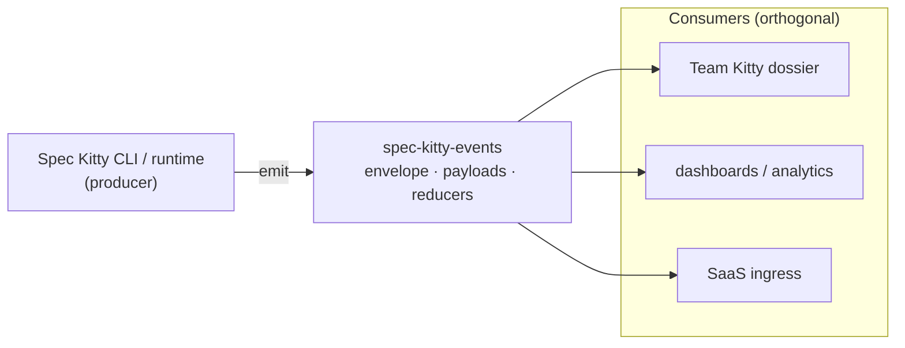

# Context

`spec-kitty-events` is the **event-contract surface** of Spec Kitty. When the Spec Kitty CLI
or runtime does something worth recording — a Mission starts, a work package changes lane, an
audit returns a verdict — it emits an event. This package defines what that event looks like:
its envelope, its typed payload, and the rules for ordering and reducing a stream of them.

It is deliberately small and dependency-light. It carries **contracts, not behaviour**: no
CLI, no orchestration, no network. That is what lets every other system read Spec Kitty's
events without taking on the CLI as a dependency.

## The Build Kitty product line

Spec Kitty is organised into three product-line brands. **Build Kitty** is the free CLI and
its extension surface — the tool that specifies, plans, builds and reviews. **Brain Kitty**
is the knowledge-and-specification side (the charter and its packs). **Team Kitty** is the
gateway and the paid, team-facing surfaces.

`spec-kitty-events` sits squarely in **Build Kitty**: it is the event-contract surface the
CLI and runtime produce. Where [`spec-kitty-charter`](https://github.com/spec-kitty/spec-kitty-charter)
(Brain Kitty) *answers questions* about governance, this repository *records what happened*
and hands it to anyone who needs to observe or reconstruct it. The charter is not an event
producer; events come from the CLI's one canonical event writer and follow these contracts.

## Producer, contract, consumer

- **One producer, many consumers.** The CLI's central emitter is the only sanctioned
  producer of canonical events. Consumers never write to each other; they each read the same
  contract.
- **The contract is the only coupling.** A consumer imports `spec_kitty_events`, validates
  and reduces, and is insulated from how the CLI produced the event. The CLI can change
  internally as long as the emitted contract holds.
- **Fail-closed where it matters.** Local history is read permissively so users never lose
  their own data; durable journal and TeamSpace ingress are gated fail-closed by the
  [strict profile](/api/strict-profile/).

## In this section

- [System context](/context/system-context/) — the systems around the contract: the CLI
  core that produces events, the transports they travel on, and the consumers that read them.

## Where to go next

- [Event families](/events/) — what events exist, grouped by concern.
- [API & Contracts](/api/) — how to consume the contract from Python.
- [Architecture](/architecture/) — how the contract is shaped and ordered.
