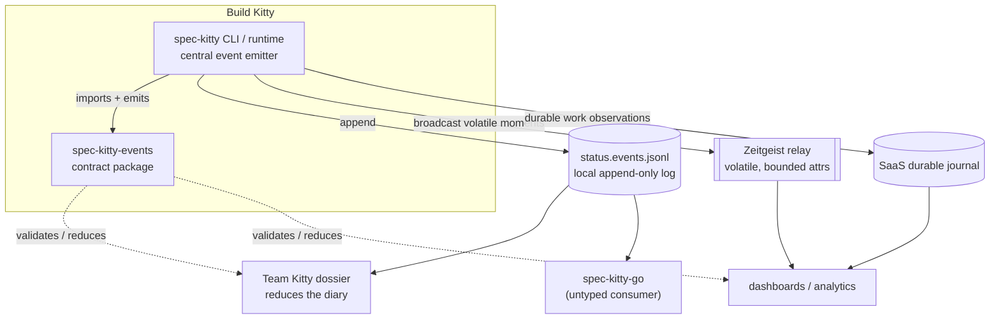

# System context

This page places `spec-kitty-events` between the Spec Kitty CLI that produces events and the
systems that consume them. It explains the three transports an event can travel on and why
consumers stay decoupled from the producer.

## The neighbours

## How the CLI core produces events

The CLI holds a single sanctioned path for emitting canonical events. Centralising it means
one place enforces the envelope shape, the Lamport clock (optional for local ledgers since
11.0.0) and the forbidden-key rules, so no corner of the CLI invents its own vocabulary.
The local-only classification (`LOCAL_ONLY_EVENT_TYPES`) is removed in 11.0.0: every
modelled event type is canonical.

Identity on every envelope is build-scoped, not team-scoped: `build_id` is the checkout that
produced the event and `node_id` is the causal emitter. Team routing, sharing and approval
are host-product policy and deliberately **not** part of this contract.

## Three transports

An event reaches consumers on one of three paths, and the contract's
[durability split](/architecture/durability-and-relay/) decides which:

| Transport | Carries | Validity |
|---|---|---|
| **`status.events.jsonl`** | the local, append-only status diary the CLI writes to disk | read permissively by the CLI so users never lose their own history |
| **Zeitgeist relay** | volatile "moments" (presence, lane signals, decision broadcasts) projected to a bounded `attrs` wire shape | retention-window only; never the durable record |
| **Durable journal** | durable `WorkObservation` streams and journal-profile events | gated fail-closed by the [strict profile](/api/strict-profile/) |

## Why consumers stay orthogonal

A consumer depends on `spec_kitty_events` — a small Pydantic package — and nothing else of
Spec Kitty's. It validates a payload with `validate_event`, gates an envelope with
`validate_strict_envelope`, and folds a stream with a family reducer. The
[Team Kitty dossier](/events/) re-uses the very same status-diary reducer the CLI uses, so
producer and consumer agree by construction rather than by convention.

Not every consumer is Python. `spec-kitty-go` carries the work-package lane as a bare string
by design; it cannot import the `Lane` enum, which is one reason a lane change is always a
major version bump — the version number is the only reliable cross-language coordination
signal. See [lane vocabulary](/api/lane-vocabulary/) and
[versioning](/api/versioning-and-compatibility/).

## See also

- [Durability and the relay](/architecture/durability-and-relay/) — journal versus volatile,
  and the Zeitgeist `attrs` codec.
- [The Python package](/api/python-package/) — the import surface a consumer uses.
