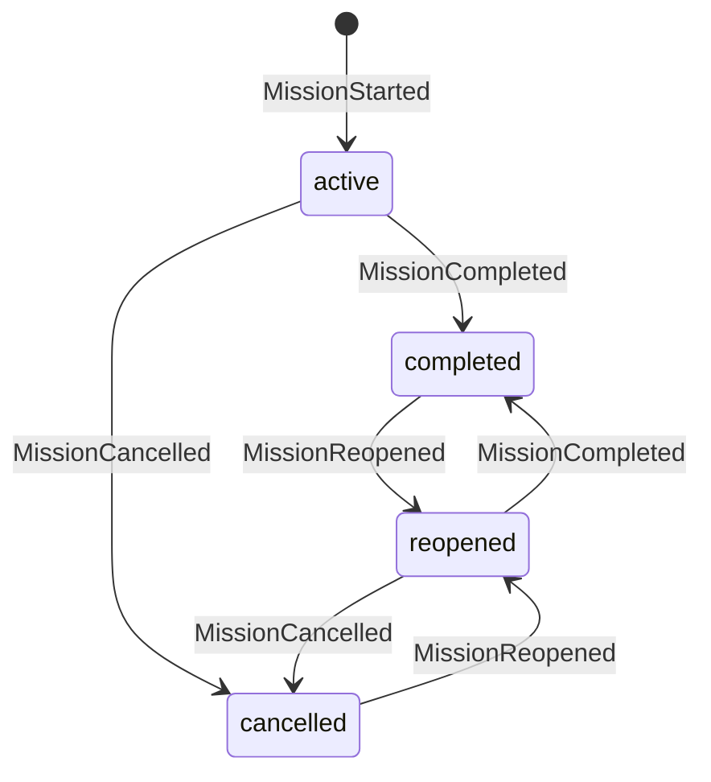

# Mission Lifecycle Events

The mission-lifecycle families record the coarse-grained shape of a mission:
when it is created and closed, which phase it is in, when it is completed,
cancelled or reopened, and how a single automated run advances through its
steps. They are emitted by the Spec Kitty CLI and runtime as a mission
progresses and are consumed by the SaaS journal, the mission dashboard and any
reducer that needs a mission's current status.

Three modules carry these families. `lifecycle.py` holds the mission-level
events and the authoritative lifecycle reducer; `project_lifecycle.py` holds the
project-and-artifact events that frame the planning phases and work packages;
`mission_next.py` holds the run-execution family that drives one mission run.

## Mission-level lifecycle — `lifecycle.py`

The mission-level family tracks a mission's catalog entry and its status over
time. Its reducer also delegates work-package reduction to the status family.

| Event type | Payload model | Meaning |
|---|---|---|
| `MissionCreated` | `MissionCreatedPayload` | A mission is entered in the catalog (optional `actor`, carries who created it). |
| `MissionClosed` | `MissionClosedPayload` | The catalog entry is closed. |
| `MissionStarted` | `MissionStartedPayload` | The mission becomes `active`; sets `mission_id`, `mission_type` and the initial phase. |
| `MissionCompleted` | `MissionCompletedPayload` | The mission reaches the terminal `completed` status. |
| `MissionCancelled` | `MissionCancelledPayload` | The mission reaches the terminal `cancelled` status. |
| `MissionOriginBound` | `MissionOriginBoundPayload` | The mission is bound to its origin (e.g. an upstream reference). |
| `PhaseEntered` | `PhaseEnteredPayload` | The mission enters a named phase; appended to the ordered `phases_entered`. |
| `ReviewRollback` | `ReviewRollbackPayload` | A review sends work backward; applied last within a concurrent group. |
| `MissionReopened` | `MissionReopenedPayload` | A completed/cancelled mission returns to the actionable `reopened` state. |
| `FollowUpRecorded` | `FollowUpRecordedPayload` | A follow-up is recorded against the mission. |

The status vocabulary is `MissionStatus`: `active`, `completed`, `cancelled`
and `reopened`. Only `completed` and `cancelled` are in
`TERMINAL_MISSION_STATUSES`; `reopened` is deliberately non-terminal, so a fresh
`MissionCompleted` after a reopen is processed normally rather than flagged as a
post-terminal anomaly. The nine mission-level types above make up
`MISSION_EVENT_TYPES` (`MissionOriginBound` is defined as a type but is not a
member of that frozenset).

**Reducer.** `reduce_lifecycle_events` folds a sequence of events into a
frozen `ReducedMissionState` — `mission_id`, `mission_status`, `mission_type`,
`current_phase`, the ordered `phases_entered`, a `wp_states` map, `anomalies`,
`event_count` and `last_processed_event_id`. It filters mission-level events to
`MISSION_EVENT_TYPES`, delegates every `WPStatusChanged` event to
`reduce_status_events` (see [work and status](/events/work-and-status/)), and
merges the resulting `WPState` map into `wp_states`.

**Durability.** These events are journaled and reduced into durable state. A
subset — `MissionCreated`, `MissionClosed` and `PhaseEntered` — is also
projected onto the volatile Zeitgeist relay (`VOLATILE_EVENT_TYPES` in
`zeitgeist_attrs.py`) as live mission moments.

## Project and artifact lifecycle — `project_lifecycle.py`

This family frames project initialization, the three planning-phase artifacts,
and work-package bookkeeping. It defines payloads and three grouped frozensets;
it has no reducer of its own.

| Event type | Payload model | Meaning |
|---|---|---|
| `ProjectInitialized` | `ProjectInitializedPayload` | A project is initialized. |
| `SpecifyStarted` / `SpecifyCompleted` | `SpecifyStartedPayload` / `SpecifyCompletedPayload` | The specify artifact phase opens / closes. |
| `PlanStarted` / `PlanCompleted` | `PlanStartedPayload` / `PlanCompletedPayload` | The plan artifact phase opens / closes. |
| `TasksStarted` / `TasksCompleted` | `TasksStartedPayload` / `TasksCompletedPayload` | The tasks artifact phase opens / closes. |
| `WPCreated` | `WPCreatedPayload` | A work package is created. |
| `WPAssigned` | `WPAssignedPayload` | A work package is assigned. |
| `HistoryAdded` | `HistoryAddedPayload` | A history entry is added to a work package. |
| `ErrorLogged` | `ErrorLoggedPayload` | An error is logged against a work package. |
| `DependencyResolved` | `DependencyResolvedPayload` | A work-package dependency is resolved. |

The groupings are `PROJECT_LIFECYCLE_EVENT_TYPES` (`ProjectInitialized`),
`ARTIFACT_LIFECYCLE_EVENT_TYPES` (the six Specify/Plan/Tasks types) and
`WP_LIFECYCLE_EVENT_TYPES` (the five WP types); their union is
`CANONICAL_LIFECYCLE_EVENT_TYPES`. The artifact phases are enumerated by
`ArtifactPhase` (`specify`, `plan`, `tasks`).

**Durability.** Journaled. The six artifact-phase start/complete types are also
projected onto the volatile relay (`VOLATILE_EVENT_TYPES`).

## Mission run execution — `mission_next.py`

This family drives a single automated mission run: the sequence of steps a
runtime issues, auto-completes, and the decision inputs it blocks on.

| Event type | Payload model | Meaning |
|---|---|---|
| `MissionRunStarted` | `MissionRunStartedPayload` | A run begins; sets `run_id`, `mission_type` and the `RuntimeActorIdentity`. |
| `NextStepIssued` | `NextStepIssuedPayload` | A step is issued and becomes the current step. |
| `NextStepAutoCompleted` | `NextStepAutoCompletedPayload` | The current step is auto-completed and appended to `completed_steps`. |
| `DecisionInputRequested` | `DecisionInputRequestedPayload` | The run requests a decision input, keyed by `decision_id`. |
| `DecisionInputAnswered` | `DecisionInputAnsweredPayload` | A requested decision is answered. |
| `MissionRunCompleted` | `MissionRunCompletedPayload` | The run reaches the terminal `completed` status. |

`MISSION_NEXT_EVENT_TYPES` also contains `NextStepPlanned` (constant
`NEXT_STEP_PLANNED`, string `"NextStepPlanned"`), which is **reserved**: its
payload contract is deferred until the runtime emits it, so no payload model is
defined. The run status vocabulary is `MissionRunStatus` (`running`,
`completed`); only `completed` is terminal (`TERMINAL_RUN_STATUSES`).

**Reducer.** `reduce_mission_next_events` folds run events into a frozen
`ReducedMissionRunState` — `run_id`, `mission_type`, `run_status`,
`current_step_id`, the ordered `completed_steps`, the `pending_decisions` and
`answered_decisions` maps (keyed by `decision_id`), `anomalies`, `event_count`
and `last_processed_event_id`.

**Durability.** Journaled and reduced into durable run state. Every mission-run
type (`MissionRunStarted`, `NextStepIssued`, `NextStepAutoCompleted`,
`DecisionInputRequested`, `DecisionInputAnswered`, `MissionRunCompleted`) is
also projected onto the volatile relay as a live run moment.

## See also

- [Work and status events](/events/work-and-status/) — the `WPStatusChanged`
  family this reducer delegates to.
- [Review, audit and decision events](/events/review-audit-decisions/) — the
  decision-point family that mission-run decision inputs relate to.
- [The Python package](/api/python-package/) — how to import these models,
  validate an event and call a reducer.
- [Ordering and reduction](/architecture/ordering-and-reduction/) — how a
  reducer orders and deduplicates events before folding.
