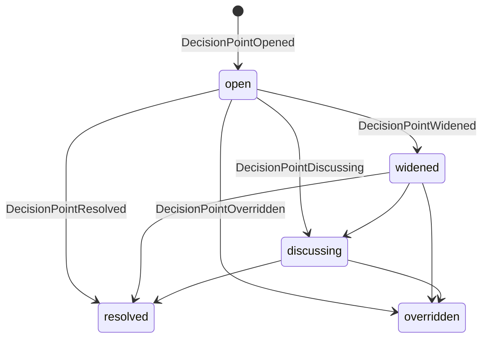

# Review, Audit and Decision Events

These families record the review and governance surface of a mission: the
decision points a mission opens and resolves, the audits it runs, the
retrospective it captures, the parity of its dossier artifacts, and the CI
gates that pass or fail on its pull requests. They are emitted by the Spec
Kitty CLI and runtime and consumed by the mission dashboard, the audit journal
and the dossier parity checker.

## Decision points — `decisionpoint.py`

A decision point is a question a mission opens, optionally widens to a broader
audience, discusses, and resolves (or has overridden). Shared value objects
live in `decision_moment.py`.

| Event type | Payload model | Meaning |
|---|---|---|
| `DecisionPointOpened` | `DecisionPointOpenedAdrPayload` / `DecisionPointOpenedInterviewPayload` | A decision point opens (variant by `origin_surface`). |
| `DecisionPointWidened` | `DecisionPointWidenedPayload` | The decision is widened to a broader audience. |
| `DecisionPointDiscussing` | `DecisionPointDiscussingAdrPayload` / `DecisionPointDiscussingInterviewPayload` | The decision enters discussion. |
| `DecisionPointResolved` | `DecisionPointResolvedAdrPayload` / `DecisionPointResolvedInterviewPayload` | The decision is resolved. |
| `DecisionPointOverridden` | `DecisionPointOverriddenPayload` | The decision is overridden. |

The five types make up `DECISION_POINT_EVENT_TYPES`. The state vocabulary is
`DecisionPointState` (`open`, `widened`, `discussing`, `resolved`,
`overridden`); `DecisionAuthorityRole` names who may decide (`mission_owner`,
`advisory`, `informed`). The opened/discussing/resolved payloads are
discriminated unions over `origin_surface` (ADR vs planning interview). Shared
models from `decision_moment.py` include `OriginSurface`, `OriginFlow`,
`TerminalOutcome`, `WideningChannel` and `WideningProjection`.

**Reducer.** `reduce_decision_point_events` runs sort → dedup →
filter(`DECISION_POINT_EVENT_TYPES`) → fold → freeze into a
`ReducedDecisionPointState`, carrying the current `state`, the identity fields
(`decision_point_id`, `mission_id`, `run_id`, `mission_slug`), the V1 projection
(`origin_surface`, `question`, `options`, `widening`, `terminal_outcome`,
`final_answer`, participants, `resolved_by`) and `anomalies`.

**Durability.** Journaled. `DecisionPointOpened` and `DecisionPointResolved` are
also projected onto the volatile relay (`VOLATILE_EVENT_TYPES`).

## Mission audit — `mission_audit.py`

The mission-audit family records one audit run from request to terminal
verdict.

| Event type | Payload model | Meaning |
|---|---|---|
| `MissionAuditRequested` | `MissionAuditRequestedPayload` | An audit is requested. |
| `MissionAuditStarted` | `MissionAuditStartedPayload` | The audit run starts (`running`). |
| `MissionAuditDecisionRequested` | `MissionAuditDecisionRequestedPayload` | The audit blocks awaiting a decision. |
| `MissionAuditCompleted` | `MissionAuditCompletedPayload` | The audit completes with a verdict. |
| `MissionAuditFailed` | `MissionAuditFailedPayload` | The audit fails (error code/message). |

The five types make up `MISSION_AUDIT_EVENT_TYPES`
(`AUDIT_SCHEMA_VERSION` `2.5.0`). The vocabularies are `AuditVerdict` (`pass`,
`pass_with_warnings`, `fail`, `blocked_decision_required`), `AuditSeverity`
(`info`, `warning`, `error`, `critical`) and `AuditStatus` (`pending`,
`running`, `awaiting_decision`, `completed`, `failed`); `completed` and `failed`
are terminal (`TERMINAL_AUDIT_STATUSES`).

**Reducer.** `reduce_mission_audit_events` runs sort → dedup →
filter(`MISSION_AUDIT_EVENT_TYPES`) → reduce → freeze into a
`ReducedMissionAuditState` — `audit_status`, `verdict`, `severity`,
`findings_count`, artifact refs, `pending_decisions`, the mission identity
fields and `anomalies`.

**Durability.** Journaled and reduced into durable audit state.

## Retrospectives — `retrospective.py`

The retrospective family has two shapes: two terminal `PascalCase` event types
and a dot-named lifecycle/proposal vocabulary (`RETROSPECTIVE_SCHEMA_VERSION`
`4.1.0`). It defines payloads only; it has no reducer.

| Event type | Payload model | Meaning |
|---|---|---|
| `RetrospectiveCompleted` | `RetrospectiveCompletedPayload` | Terminal: the retrospective is captured. |
| `RetrospectiveSkipped` | `RetrospectiveSkippedPayload` | Terminal: the retrospective is skipped. |
| `retrospective.requested` | `RetrospectiveRequestedPayload` | A retrospective is requested. |
| `retrospective.started` | `RetrospectiveStartedPayload` | A retrospective run starts. |
| `retrospective.completed` | `RetrospectiveLifecycleCompletedPayload` | The run completes. |
| `retrospective.skipped` | `RetrospectiveLifecycleSkippedPayload` | The run is skipped. |
| `retrospective.failed` | `RetrospectiveFailedPayload` | The run fails. |
| `retrospective.proposal.generated` | `RetrospectiveProposalGeneratedPayload` | A proposal is generated. |
| `retrospective.proposal.applied` | `RetrospectiveProposalAppliedPayload` | A proposal is applied. |
| `retrospective.proposal.rejected` | `RetrospectiveProposalRejectedPayload` | A proposal is rejected. |

The eight dot-named strings are `RETROSPECTIVE_EVENT_NAMES`; the full set,
including the two terminal `PascalCase` types, is `RETROSPECTIVE_EVENT_TYPES`.

**Durability.** Journaled. The dot-named lifecycle rows use the non-lane
`type` envelope shape and pass through the status diary unchanged.

## Mission dossier — `dossier.py`

The dossier family records artifact parity for a mission dossier: which
artifacts are indexed, which are missing, the computed snapshot, and any drift
between snapshots.

| Event type | Payload model | Meaning |
|---|---|---|
| `MissionDossierArtifactIndexed` | `MissionDossierArtifactIndexedPayload` | An artifact is indexed into the dossier. |
| `MissionDossierArtifactMissing` | `MissionDossierArtifactMissingPayload` | An expected artifact is not found. |
| `MissionDossierSnapshotComputed` | `MissionDossierSnapshotComputedPayload` | A deterministic snapshot of dossier state is computed. |
| `MissionDossierParityDriftDetected` | `MissionDossierParityDriftDetectedPayload` | A parity drift between snapshots is detected. |

The four types make up `DOSSIER_EVENT_TYPES`. Events are namespaced by a
`LocalNamespaceTuple`; `reduce_mission_dossier` filters to
`DOSSIER_EVENT_TYPES` and folds into a `MissionDossierState` (artifact entries,
anomalies, snapshot summary, drift records), raising
`NamespaceMixedStreamError` if events from more than one namespace are mixed.

**Durability.** Journaled and reduced into durable dossier state.

## CI gates — `gates.py`

The gate family records CI check-run outcomes as pass/fail observability
events.

| Event type | Payload model | Meaning |
|---|---|---|
| `GatePassed` | `GatePassedPayload` | A CI gate concluded `success`. |
| `GateFailed` | `GateFailedPayload` | A CI gate concluded `failure`, `timed_out`, `cancelled` or `action_required`. |

Both payloads extend `GatePayloadBase` (gate name, type, raw conclusion,
provider, check-run id/url, delivery id, optional PR number).
`map_check_run_conclusion` maps a raw GitHub conclusion to `"GatePassed"`,
`"GateFailed"` or `None` (for the ignored `neutral`, `skipped`, `stale`), and
raises `UnknownConclusionError` on an unknown value. There is no reducer.

**Durability.** Journaled observability rows; keyed by the webhook `delivery_id`
for idempotency.

## See also

- [Mission lifecycle events](/events/mission-lifecycle/) — the mission-level
  status these reviews act on.
- [Work and status events](/events/work-and-status/) — the lane transitions a
  review rollback drives.
- [The Python package](/api/python-package/) — how to import, validate and
  reduce these events.
- [Ordering and reduction](/architecture/ordering-and-reduction/) — how each
  reducer orders and deduplicates its events.
