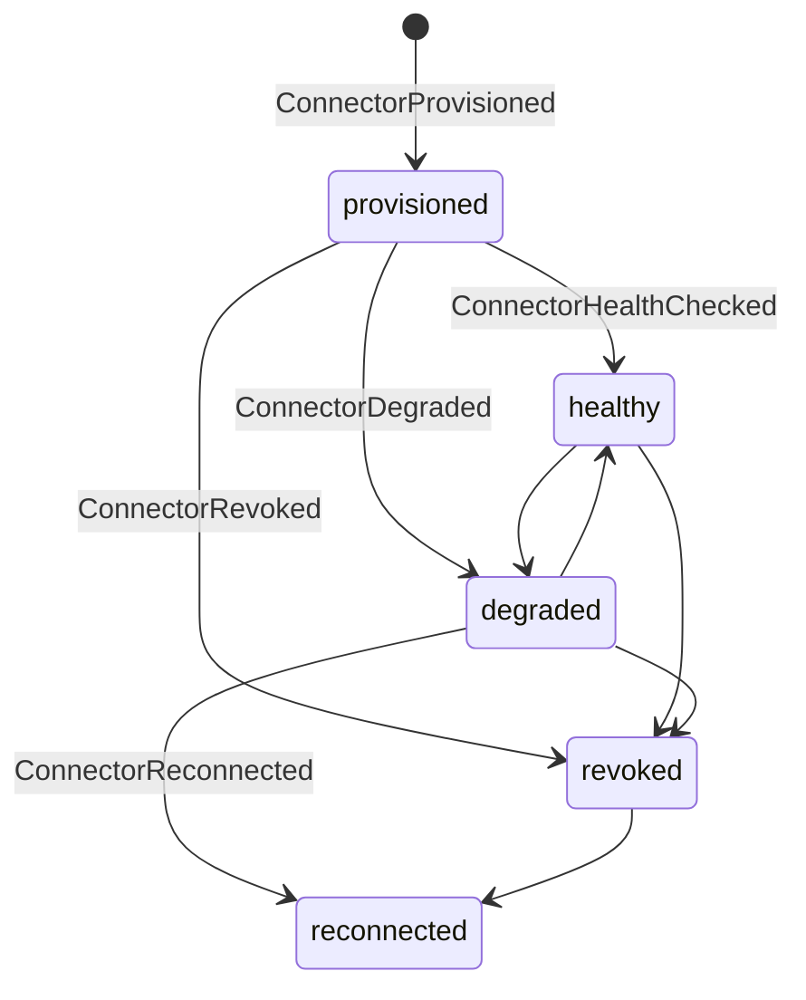

# Runtime Observation Events

Runtime-observation families describe what the Spec Kitty runtime and its
harness are doing around a mission: who is present, what work is happening,
which builds are alive, which profiles and ops invocations run, and the health
of external connectors. They are emitted by the CLI and runtime; the volatile
families feed the live Zeitgeist relay, while the durable families feed the
SaaS journal.

This page covers the clearest split in the contract between **volatile**
(broadcast-only, never durable state) and **durable** (accepted into the
journal) observation.

## Harness observation (volatile) — `harness_observation.py`

The harness-observation family is the volatile agent-presence feed. One event
type carries a closed set of six kinds.

| Event type | Payload model | Meaning |
|---|---|---|
| `HarnessObservation` | `HarnessObservationPayload` | A volatile presence/focus signal, discriminated by `kind`. |

`ObservationKind` is a closed six-member set: `presence`, `lane_signal`,
`focus_started`, `focus_heartbeat`, `focus_paused`, `focus_ended`
(`HARNESS_OBSERVATION_CONTRACT_VERSION` `1`). Each kind maps to a payload id
`harness.<kind>.v1` via `PAYLOAD_ID_BY_KIND`, and the kinds' per-field rules are
enforced by `_KIND_FIELD_RULES`; forbidden keys are pinned by
`FORBIDDEN_OBSERVATION_KEYS`.

**Durability.** Volatile. `HarnessObservation` is never reduced into
mission/WP state; it exists only on the Zeitgeist relay for the retention
window.

## Work observation (durable) — `work_observation.py`

The work-observation family is the single owner of the durable live-work
vocabulary. One event type carries a closed set of 25 kinds across six
families.

| Event type | Payload model | Meaning |
|---|---|---|
| `WorkObservation` | `WorkObservationPayload` | A durable live-work record, discriminated by `WorkKind`. |

`WorkKind` has exactly 25 members in six families, grouped by the `WORK_FAMILIES`
frozenset (`lifecycle`, `session`, `action`, `narrative`, `message`,
`coverage`):

- **lifecycle (6)** — `lifecycle.mission_review_captured` / `_failed` /
  `_skipped`, `lifecycle.retrospective_captured` / `_failed` / `_skipped`.
- **session (5)** — `session.started`, `session.ended`,
  `session.delegation_started`, `session.delegation_ended`,
  `session.binding_changed`.
- **action (3)** — `action.tool_invoked`, `action.file_edited`,
  `action.test_executed`.
- **narrative (9)** — `narrative.intent_declared`, `narrative.progress_reported`,
  `narrative.question_asked`, `narrative.question_answered`,
  `narrative.decision_recorded`, `narrative.handoff_performed`,
  `narrative.blocker_raised`, `narrative.blocker_resolved`,
  `narrative.next_proposed`.
- **message (1)** — `message.peer_sent`.
- **coverage (1)** — `coverage.gap_recorded`.

`WORK_FAMILY_BY_KIND` maps every kind to its family; `PAYLOAD_ID_BY_KIND` maps
every kind to a payload id `work.<kind>.v<version>`, and
`WORK_OBSERVATION_PAYLOAD_IDS` is the set of 25 payload-id strings consumers pin
against. `canonical_work_hash` and `work_aggregate_id` derive the stable hash
and aggregate id; `WorkRejectionReason` names ingress rejections.

`work_replay.py` classifies a replayed work stream: `work_item_from_event`
builds a `WorkStreamItem`, `replay_order_key` orders it, and
`classify_work_stream(items)` returns a `WorkStreamReport` (with `SequenceGap`
records).

**Durability.** Durable. Work observation is accepted into the SaaS journal and
is deliberately routed outside the lossy volatile codec of `zeitgeist_attrs.py`
— that codec is for volatile mission/WP moments only.

## Build lifecycle — `build_lifecycle.py`

| Event type | Payload model | Meaning |
|---|---|---|
| `BuildRegistered` | `BuildRegisteredPayload` | A build registers with the runtime. |
| `BuildHeartbeat` | `BuildHeartbeatPayload` | A registered build reports a heartbeat. |

The two types make up `BUILD_LIFECYCLE_EVENT_TYPES`. No reducer.

## Profile invocation — `profile_invocation.py`

| Event type | Payload model | Meaning |
|---|---|---|
| `ProfileInvocationStarted` | `ProfileInvocationStartedPayload` | A governance profile invocation starts. |

Only `ProfileInvocationStarted` is validatable
(`PROFILE_INVOCATION_EVENT_TYPES`; `PROFILE_INVOCATION_SCHEMA_VERSION` `3.1.0`).
`ProfileInvocationCompleted` and `ProfileInvocationFailed` are **reserved**
name-only types (`PROFILE_INVOCATION_RESERVED_TYPES`) with deferred payload
contracts — not yet validatable. No reducer.

## Ops invocation — `ops_invocation.py`

| Event type | Payload model | Meaning |
|---|---|---|
| `OpsInvocationStarted` | `OpsInvocationStartedPayload` | An ops invocation starts. |
| `OpsInvocationCompleted` | `OpsInvocationCompletedPayload` | An ops invocation reaches a terminal outcome. |

The two types make up `OPS_INVOCATION_EVENT_TYPES`; `OpsInvocationOutcome` is
`success` or `failure`. No reducer.

**Durability.** Journaled; both types are also projected onto the volatile relay
(`VOLATILE_EVENT_TYPES`).

## Connectors — `connector.py`

The connector family tracks the lifecycle of an external connector plus
user-level connect/disconnect (`CONNECTOR_SCHEMA_VERSION` `2.8.0`).

| Event type | Payload model | Meaning |
|---|---|---|
| `ConnectorProvisioned` | `ConnectorProvisionedPayload` | A connector is provisioned. |
| `ConnectorHealthChecked` | `ConnectorHealthCheckedPayload` | A health check reports the connector healthy. |
| `ConnectorDegraded` | `ConnectorDegradedPayload` | The connector is degraded. |
| `ConnectorRevoked` | `ConnectorRevokedPayload` | The connector is revoked. |
| `ConnectorReconnected` | `ConnectorReconnectedPayload` | The connector is reconnected. |
| `UserConnected` | `UserConnectedPayload` | A user connects (user-level). |
| `UserDisconnected` | `UserDisconnectedPayload` | A user disconnects (user-level). |

The seven types make up `CONNECTOR_EVENT_TYPES`; `UserConnected` and
`UserDisconnected` are the `_USER_LEVEL_EVENT_TYPES` that skip binding-level
state transitions. The binding-state vocabulary is `ConnectorState`
(`provisioned`, `healthy`, `degraded`, `revoked`, `reconnected`); `HealthStatus`
(`healthy`, `degraded`, `unreachable`) and `ReconnectStrategy` (`automatic`,
`manual`, `backoff`) qualify checks and reconnects.

**Reducer.** `reduce_connector_events` runs sort → dedup →
filter(`CONNECTOR_EVENT_TYPES`) → fold → freeze into a
`ReducedConnectorState`, enforcing the allowed state transitions and folding
user-level connect/disconnect into a `UserConnectionStatus`.

**Durability.** Journaled and reduced into durable connector state.

## See also

- [Collaboration events](/events/collaboration/) — the live presence and
  coordination feed alongside harness observation.
- [Semantics and analytics events](/events/semantics-and-analytics/) — the
  token-usage and diff-summary analytics that observe runtime cost.
- [The Python package](/api/python-package/) — how to import, validate and
  reduce these events.
- [Durability and relay](/architecture/durability-and-relay/) — the journal vs
  volatile split these families sit on either side of.
