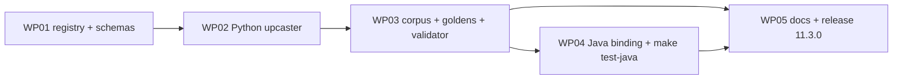

# Implementation Plan: CloudEvents envelope, type registry and legacy-row upcaster

**Branch**: `issue-92-cloudevents-envelope` | **Date**: 2026-10-27 | **Spec**: [spec.md](spec.md)
**Input**: Feature specification from `kitty-specs/cloudevents-envelope-registry-upcaster-01M5Z6VM/spec.md`

## Summary

Extend the shipped producer contract (`src/spec_kitty_events/producer_contract/`, 10.5.0) into
the full ADR 0001 envelope contract. The registry gains a `transport` mapping per entry (shape A
`event_type` and payload lifts) and the eight strict types it lacks; the `dataschema` base
becomes `urn:ai.spec-kitty:schema:`. A read-profile envelope schema sits beside today's
envelope, which becomes the write profile. A new `spec_kitty_events.cloudevents` package holds
the registry-driven upcaster, canonical serialization, a non-normative validator and the
lane-row decode. A packaged legacy corpus with byte-exact goldens is the one fixture set both
bindings run. A Maven module under `java/` (Java 25) implements the same validator and
upcaster against the same files. Release `11.3.0` (minor).

## Technical Context

**Language/Version**: Python 3.10+ (floor 3.10.21, default 3.13); Java 25 (Temurin 25, `--release 25`)
**Primary Dependencies**: Python: pydantic 2, python-ulid (existing runtime deps only); jsonschema 4 (existing optional `conformance` extra) for validation. Java: Jackson databind 2.22.x, networknt json-schema-validator 3.0.x (JSON Schema 2020-12), JUnit Jupiter 6.x; Maven via the Maven Wrapper
**Storage**: Files: committed JSON schemas, registry and fixtures (package data); JSONL logs read, never written
**Testing**: pytest + hypothesis (property tests), the packaged conformance gate (`pytest --pyargs spec_kitty_events.conformance`), JUnit 5 via `make test-java`
**Target Platform**: Library (PyPI wheel; Java module built from source, not published)
**Project Type**: single (Python package) plus a sibling Java build under `java/`
**Performance Goals**: upcast 10,000 diary rows in < 2 s (Python, CI hardware)
**Constraints**: deterministic, no log rewrite, no live-path change, no new Python runtime dependency, schemas are the source of truth (charter Language Bindings)
**Scale/Scope**: 36 registered types; corpus of ~150 legacy rows

## Charter Check

| Charter rule | Status |
|---|---|
| Committed schemas and fixtures are the public contract; Java binding allowed beside Python, same fixtures (Language Bindings, 2026-10-15) | Pass: both bindings load `producer_contract/` and the corpus from the package tree; Java reads them in place, with no copy |
| Quality gates: pytest, committed-schema drift checks, `mypy --strict` | Pass: composed schemas regenerated with a drift test; new modules typed strictly |
| Review policy: envelope/schema/fixture changes need deliberate compatibility review | Pass: COMPATIBILITY `11.3.0` section, adversarial squad before the PR |
| Directive 1: no silent compatibility aliases, no live-path mutation without a cutover decision | Pass: the upcaster is named, published row by row and fixture-pinned; `validate_strict_envelope` and producers unchanged; the `doing`→`in_progress` mapping is published in the registry |
| Central CLI-SaaS contract | No change in this release: SaaS ingress is not altered (the 12.0.0 cutover owns that) |
| DIRECTIVE_051 supply chain (new Maven deps) | See research.md R-6: pinned versions, Central only, checksums verified by Maven, the wrapper's distribution checksum pinned |

## Project Structure

### Documentation (this feature)

```
kitty-specs/cloudevents-envelope-registry-upcaster-01M5Z6VM/
├── spec.md  plan.md  research.md  data-model.md  quickstart.md
├── contracts/upcaster-contract.md
└── tasks.md, tasks/  (from /spec-kitty.tasks)
```

### Source Code (repository root)

```
src/spec_kitty_events/
├── producer_contract/
│   ├── registry.json                 # + transport mappings, 8 new types, URN base, envelope profiles
│   ├── envelope.schema.json          # write profile (unchanged rules, URN dataschema)
│   ├── envelope.read.schema.json     # NEW read profile
│   ├── data/*.schema.json            # + 8 new data schemas; lane gains optional `summary`
│   ├── composed/{rows,legacy,read}/  # regenerated; `read/` NEW
│   └── fixtures/upcast/              # NEW legacy corpus: <case>.json + goldens
├── cloudevents/                      # NEW
│   ├── __init__.py                   # public API
│   ├── _canonical.py                 # canonical serialization
│   ├── _detect.py                    # shape detection
│   ├── _upcast.py                    # registry-driven mapping
│   ├── _decode.py                    # lane CloudEvent -> diary row
│   └── _validate.py                  # read/write profile validation (needs jsonschema)
└── conformance/test_upcast_corpus.py # NEW, packaged gate
tests/test_cloudevents_*.py           # unit + property tests
java/                                 # NEW Maven module (mvnw, pom.xml, src/main, src/test)
scripts/ensure_jdk25.sh               # NEW: use JDK 25 on PATH or fetch Temurin 25 into .cache/
Makefile                              # + test-java, wired into test-full
```

**Structure Decision**: extend `producer_contract/` for data (one schema set, spec C-002) and
add `cloudevents/` for behaviour; Java lives in `java/` and reads the Python package's data
directory through Maven resource roots, so there is no second copy.

## Complexity Tracking

| Item | Why needed | Simpler alternative rejected because |
|---|---|---|
| A second language build in the repo | Spec FR-013; charter Language Bindings | A separate repo would fork the fixtures (C-002) |
| Self-provisioned JDK 25 in `make test-java` | CI runners are not guaranteed to carry JDK 25 | Requiring it on runners couples this repo to the planning repo's images |

## Parallel Work Analysis

### Dependency Graph



### Work Distribution

Sequential on one branch (single_branch topology); WP04 and WP05 docs can overlap once the
goldens exist.

### Coordination Points

The goldens (WP03) are the hand-off point: Java must reproduce them byte for byte.

## Implementation Concern Map

| Concern | Spec rows | WP |
|---|---|---|
| Registry completeness, URN base, transport mapping, new data schemas | FR-001, FR-002 | WP01 |
| Envelope profiles | FR-003 | WP01 |
| Upcaster shapes A, B, CLI forms; pass-through; strict/permissive; determinism | FR-004–FR-008, NFR-001, NFR-002, NFR-004, NFR-005 | WP02 |
| Canonical bytes, corpus, goldens, equal reduced state, validator, gate | FR-009–FR-012, FR-015, NFR-003, SC-001–SC-004 | WP03 |
| Java binding and CI | FR-013, FR-014 | WP04 |
| Release docs | FR-016 | WP05 |
