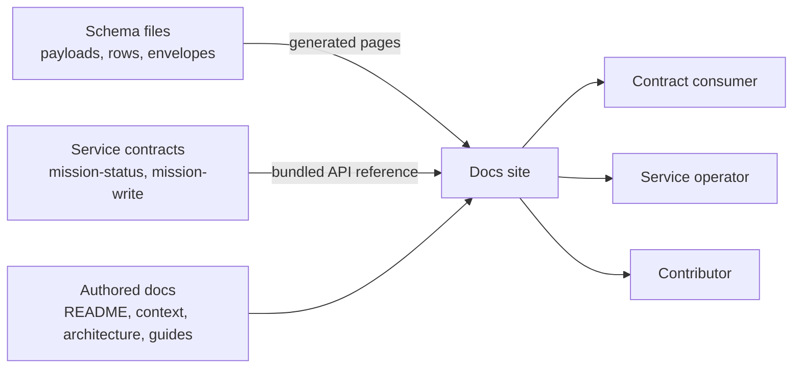

# Feature Specification: Docs site overhaul: doc-kitty 0.6.0, service docs, schema and API reference

**Mission**: `docs-site-overhaul-01M6GBDP`
**Feature Branch**: `issue-122-docs-site-overhaul` (one PR into `main`)
**Created**: 2026-11-03
**Status**: Draft
**Closes**: #181, #193, #194, #195. Parent epic: #122.
**Input**: Docs-site overhaul, one mission, one branch, one PR. Grounded by a pre-spec squad (`research.md`, 25 dispositioned findings) and two maintainer rulings: build-time diagram rendering is accepted, and every schema gets a generated page.

## Context

`spec-kitty-events` ships on two lines: the Python contract package (PyPI `v*`, now 11.3.0) and, since ADR-0002, the events-domain Java services on a `service-v*` line (now `service-v0.1.0-rc.2`). The services are the read service `mission-status-api` and the write service `command-cli`. The README and the docs entry pages still describe a package-only repository. The read and write service contracts and 168 schema files can only be read in the repository. The docs site pins doc-kitty 0.5.0, so it relies on a CI-only `rm -rf` stopgap to keep changelog fragments out of the build (#181). doc-kitty 0.6.0 adds folder exclusion, OpenAPI reference pages and Schematic (schema) pages.

## User Scenarios & Testing *(mandatory)*

### User Story 1 - A consumer browses an event schema (Priority: P1)

A developer integrating with Spec Kitty events opens the docs site, goes to an event family, and opens the page for one payload. It shows the schema's description, a diagram, a property table with types and required flags, links to the sub-models it uses, and the source schema file.

**Why this priority**: The schemas are the contract. Today a reader has to open 168 JSON files in the repository.

**Independent Test**: Build the site and open any payload page. It has a rendered diagram, a property table and a working source link, and every sub-model link resolves.

**Acceptance Scenarios**:

1. **Given** a payload schema in the package, **When** the site is built, **Then** a page for it exists, is linked from its event family page, and shows the diagram, the properties and the source file.
2. **Given** a payload that references a shared sub-model, **When** the reader follows the sub-model link, **Then** they land on that sub-model's own page.
3. **Given** the two envelope schemas, **When** the reader opens the envelope pages, **Then** the normative 3.0.0 envelope and the CloudEvents profile (non-normative until 12.0.0) are on separate pages and each says which it is.

---

### User Story 2 - An operator finds and reads the service APIs (Priority: P1)

Someone running or integrating with the read or write service starts at the README or the docs home. They learn that the services exist, which release line they ship on and how to run them, and they reach an API reference page for each service contract.

**Why this priority**: The services are invisible from every entry point (#193), and their contracts have no rendered reference (#194).

**Independent Test**: From the README and from the docs home, reach the read-service and write-service API reference pages in at most three clicks, and the running guide in at most two.

**Acceptance Scenarios**:

1. **Given** the README, **When** a reader looks for the services, **Then** it names both services, both release lines, the Gradle build and the contracts, and links to the guides and the API reference.
2. **Given** the API reference pages, **When** a reader opens either, **Then** it is marked unreleased (until the first final `service-v*` tag), and the raw contract file and its checksum are downloadable.

---

### User Story 3 - A contributor builds the docs locally as CI does (Priority: P2)

A contributor runs the documented validate and build commands locally, with the changelog fragments folder present. The result is the same as CI's: fragments are not pages, and diagrams render.

**Why this priority**: Today the fragment exclusion exists only in CI (#181), and diagram rendering is about to change mode.

**Independent Test**: With `docs/changelog/unreleased/` present and holding a fragment, the documented local validate and build succeed and publish no fragment page.

**Acceptance Scenarios**:

1. **Given** fragments in `docs/changelog/unreleased/`, **When** the contributor validates and builds locally, **Then** neither the frontmatter nor the link check flags them, and no fragment page is built.
2. **Given** the docsite guide, **When** a contributor follows it, **Then** they can render diagrams locally, or they learn exactly what is needed to do so.

---

### User Story 4 - Docs stay in step with the schemas (Priority: P2)

A maintainer adds, renames or removes a schema, or changes a service contract. The check that guards the docs fails until the pages match, and a contract or schema change triggers the docs build.

**Why this priority**: Generated pages must never drift from their only source.

**Independent Test**: Add an unpaged schema file. The drift check fails, naming it. Remove it and the check passes. A change touching only a schema or contract path still runs the docs build.

**Acceptance Scenarios**:

1. **Given** a schema without a page, **When** the drift check runs, **Then** it fails and names the schema.
2. **Given** a page whose schema is gone, **When** the drift check runs, **Then** it fails and names the page.
3. **Given** a pull request touching only `contracts/**` or the package's schema folders, **When** CI runs, **Then** the docs build runs instead of skipping.

---

### User Story 5 - Architecture and planning docs tell the truth (Priority: P2)

A reader of the architecture overview, context, guides or agent guide meets the repository as it is now: a contract authority plus the services, after cutover, with the release rule of ADR-0003.

**Why this priority**: Several pages contradict ADR-0002 and ADR-0003 or describe the cutover as pending (research.md findings 11–19).

**Independent Test**: Each stale passage listed in research.md findings 11–19 is corrected or explicitly marked historical.

**Acceptance Scenarios**:

1. **Given** `docs/architecture/overview.md`, **When** read, **Then** it describes the package and the services and no longer says the repository is not a service.
2. **Given** the contracts release section, **When** read, **Then** it matches ADR-0003 (contract bundles ride on `service-v*`) and names no retired tag line.

### Edge Cases

- The PlantUML render service is slow to start or unavailable in CI. The build waits within a bounded readiness window, then fails with a clear error. It never publishes pages without diagrams.
- A schema file that is not a single schema document, such as `registry.json` or a fixture, is excluded by rule, not by accident.
- `composed/` producer-row variants are generated from `data/` and are not paged separately.
- A generated schema page route collides with another published file. The build fails, and the generator must avoid it.
- A service contract split across files cannot be published directly. It is bundled into one file first.
- A future final `service-v*` tag flips the API reference from unreleased to released. The rule for that is written down.
- Merged `kitty-specs/` missions mention the old state. They are historical records and are not rewritten.

## Requirements *(mandatory)*

### Functional Requirements

| ID | Requirement | Status | Delivery | No-op passable? |
|---|---|---|---|---|
| FR-001 | The docs site uses doc-kitty 0.6.0, installed exactly as the committed lockfile records. (#181) | Proposed | [build] | no |
| FR-002 | `docs/changelog/unreleased/` is excluded from the site build and from the local frontmatter and link checks by toolkit configuration. The CI-only removal step is gone. (#181) | Proposed | [build] | no |
| FR-003 | Diagrams (PlantUML and Mermaid) render at build time in CI, using a PlantUML render service and a browser runtime, each pinned by digest. The build waits for the render service within a bounded window and fails if it is not ready. (#195) | Proposed | [build] | no |
| FR-004 | A new ADR-0006 records the switch to build-time diagram rendering, its pins and its trade-offs. The workflow comments, the site config comments and `docs/guides/docsite.md` match it. (#195) | Proposed | [build] | no |
| FR-005 | Every schema file in `src/spec_kitty_events/schemas/`, every row schema in `src/spec_kitty_events/producer_contract/data/`, and the two producer-contract envelope schemas has exactly one generated schema page with diagram, properties and source. `composed/`, `registry.json` and fixtures are excluded. (#195; DM-01M6GBE4ZAKE68Y49MZWR69FS5) | Proposed | [build] | no |
| FR-006 | The two envelope pages are distinct and labelled: `event.schema.json` as the normative 3.0.0 envelope, and the producer-contract envelope as the CloudEvents profile, non-normative until 12.0.0. (#195) | Proposed | [build] | no |
| FR-007 | Schema pages are produced by a committed generator. A check, run by the docs build and by `make lint`, fails when a schema lacks a page, a page names a missing schema, or a page is not linked from its family hub. (#195) | Proposed | [build] | no |
| FR-008 | Each event family page and the producer-row schemas page links to the schema pages of its family. A "shared types" hub lists the sub-models. (#195) | Proposed | [build] | no |
| FR-009 | The read-service (`mission-status`) and write-service (`mission-write`) contracts are published as API reference pages, each from a single bundled file, with the raw file and checksum downloadable. Both are marked unreleased until the first final `service-v*` tag, and the rule for flipping that flag is documented. (#194) | Proposed | [build] | no |
| FR-010 | A new `docs/api/services.md` hub introduces both service APIs and links their reference pages, the contract release rules and the service guides. The API section index links it. (#194) | Proposed | [build] | no |
| FR-011 | The docs build runs when a change touches the service contracts or the package's schema folders, in both the push trigger and the pull-request detection, and a test keeps the two path lists in agreement. | Proposed | [build] | no |
| FR-012 | `README.md` describes both release lines (PyPI `v*`, `service-v*`), the read and write services and how to run them, the Gradle build and its make targets, and the contracts, with an updated diagram and links to the guides and API reference. Every version, path and command it states exists in the repository. (#193) | Proposed | [build] | no |
| FR-013 | The docs entry pages route readers to the services: `docs/README.md` (including "Start here"), `docs/context/README.md` and `system-context.md` (the services in the diagram and prose), `docs/api/README.md`, `docs/architecture/README.md`, and the `context`, `api` and `guides` purposes in `docs/_meta/sections.yaml`. (#193) | Proposed | [build] | no |
| FR-014 | `docs/architecture/overview.md` describes the package and the services. `producer-row-schemas.md` and the architecture index reflect accepted, shipped status. The event-log append page's description no longer overstates what exists. | Proposed | [build] | no |
| FR-015 | Post-cutover truth in the guides: the guides index (no "draft until cutover"), `service-protocol-and-releases.md` and `running-the-service.md` (current rc), the cutover runbook marked executed and kept as a record, and `command-cli-research.md` marked historical. | Proposed | [build] | no |
| FR-016 | `contracts/README.md` and both contract changelogs state the ADR-0003 release rule (contract bundles ride on `service-v*`) and drop the retired `contract-<module>-v*` tag line. | Proposed | [build] | no |
| FR-017 | The glossary defines read service, write service, the `service-v*` line, launcher, `endpoint.json`, and the fail-closed write gate. | Proposed | [build] | no |
| FR-018 | `AGENTS.md` (and its `CLAUDE.md` link) drops the 0.5.0 sibling-toolkit caveat. It documents the toolkit's `--exclude`, updates the docs-site trigger paths and the "inert until cutover" wording, and adds the rule that a mission covering several issues may land as one branch and one PR that closes them all. The same wording is fixed in the `service.yml` and `service-release.yml` comments. | Proposed | [build] | no |
| FR-019 | ADR-0005 gets a dated amendment note that the fragment-folder stopgap has been replaced by toolkit exclusion. | Proposed | [build] | no |
| FR-020 | The tests that pinned the old docs-site behaviour (the fragment-removal step, "no `--exclude` in AGENTS.md", the docs-detect path table) assert the new behaviour. New tests pin the build-time render mode and the digest-pinned images. | Proposed | [build] | no |
| FR-021 | Each closed issue (#181, #193, #194, #195) has a changelog fragment in `docs/changelog/unreleased/`. | Proposed | [build] | no |

### Non-Functional Requirements

| ID | Requirement | Status |
|---|---|---|
| NFR-001 | A docs build in CI with a warm diagram cache completes in at most 15 minutes, and a cold build in at most 30 minutes. | Proposed |
| NFR-002 | The render-service readiness wait is bounded at 120 seconds or less. On timeout the build fails with a message naming the service. | Proposed |
| NFR-003 | 100% of the schema files in scope have a page, 100% of pages resolve to a schema, and 0 schema pages are built without a rendered diagram. The build checks the count. | Proposed |
| NFR-004 | 0 broken links in the built site (`check:built-links`) and 0 frontmatter or source-link findings (`npm run validate`), with the fragment folder present on disk. | Proposed |
| NFR-005 | Every container image and render service used by the docs build is pinned by an immutable digest (100% of them). | Proposed |

### Constraints

| ID | Constraint | Status |
|---|---|---|
| C-001 | Schema and contract files are the single source. Generated pages are never hand-edited, and staged copies are not committed. | Active |
| C-002 | `docs-build` stays a required check and must pass on the PR. Its job name does not change. | Active |
| C-003 | Merged `kitty-specs/` missions are not rewritten. | Active |
| C-004 | No change to the event contract itself: no schema, payload, envelope or OpenAPI content changes, and no package or service version bump. Documentation and tooling only. | Active |
| C-005 | One branch (`issue-122-docs-site-overhaul`) and one PR into `main` closing #181, #193, #194 and #195, per the maintainer ruling recorded in research.md. | Active |
| C-006 | Out of scope: the programme planning repo (spec-kitty/spec-kitty-planning#2683), the placement of service-line releases in `CHANGELOG.md` (#196), and CSP hashes. | Active |
| C-007 | ADRs are immutable logs. Changes to ADR-0005 are amendments; the new decision is a new ADR. | Active |

### Key Entities

- **Schema page**: a generated docs page bound to exactly one schema file. It belongs to one family hub (or the shared-types hub).
- **Family hub**: an authored event-family page (`docs/events/*.md`) or the producer-row page. It lists its schema pages.
- **Service API reference**: a published, versioned reference generated from one bundled service contract, carrying a released or unreleased flag.
- **Staged input**: a build-time copy of a schema or bundled contract placed where the site build can read it. It is never committed.

## Success Criteria *(mandatory)*

### Measurable Outcomes

- **SC-001**: A reader reaches any event payload's schema page from the docs home in at most 3 clicks, and every schema page shows a rendered diagram. — [build] · no-op passable: no
- **SC-002**: A reader reaches each service's API reference from the README or the docs home in at most 3 clicks. — [build] · no-op passable: no
- **SC-003**: 0 pages on the published site describe the repository as package-only or the service cutover as pending (checked against the passages listed in research.md findings 11–19). — [build] · no-op passable: no
- **SC-004**: A contributor following the docsite guide gets the same validate and build result locally as CI does, with the fragments folder present. — [build] · no-op passable: no
- **SC-005**: Adding one schema without a page, or one page without a schema, makes the guarding check fail, naming the file. — [build] · no-op passable: no
- **SC-006**: All four issues (#181, #193, #194, #195) close with the single merged PR. — [build] · no-op passable: no

## Assumptions

- doc-kitty 0.6.0 behaves as its tag documents (verified from source for render-mode scope and schema-path root; research.md). The OpenAPI integration needs single-file specs, which `contracts/tools/bundle.py` produces.
- spec-kitty-charter's 0.6.0 setup (Playwright container, sandboxed PlantUML server, readiness probe, diagram cache, staging script) is a sound pattern to follow.
- GitHub Pages sends no CSP, so no CSP hashes are needed.
- Mermaid renders at build time too, because the toolkit's render mode is site-wide.

## Domain Language

| Canonical term | Meaning | Avoid |
|---|---|---|
| read service | `mission-status-api`, the loopback read-only status service | "status API server", "dashboard backend" |
| write service | `command-cli`, the loopback write service | "write API", "CLI service" |
| `service-v*` line | the release line of the services and contract bundles | "contract release", "contract-v*" |
| normative envelope | `event.schema.json`, envelope schema 3.0.0 | "the envelope" without qualification |
| CloudEvents profile | the producer-contract envelope, non-normative until 12.0.0 | "new envelope" |
| schema page | a generated page bound to one schema file | "schematic" (toolkit term only) |
