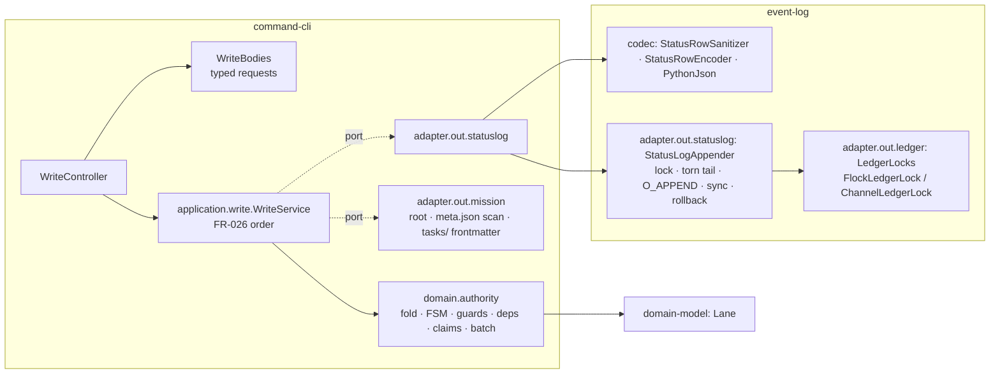
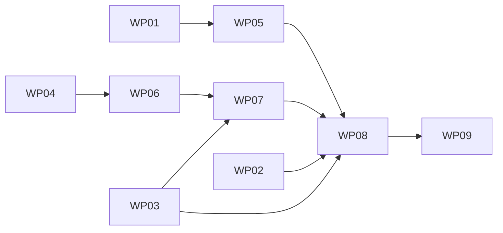

# Implementation Plan: command-cli write core — canonical writer, lane authority and the lane-transition cut-over

**Branch**: `kitty/mission-events-write-core-01M6TP6W` (pushed as `issue-160-write-core`) | **Date**: 2026-11-07 | **Spec**: [spec.md](./spec.md)
**Input**: the mission specification, with the research in [research.md](./research.md) (the port inventory, §1–§10, plus the decisions in §11).

## Summary

`command-cli` refuses every write today: `WriteGate.persist()` answers `500 STATUS_EVENT_PERSISTENCE_VERIFICATION_FAILED`. This plan replaces that refusal with a real write path that has three parts.

1. **Canonical writer (#160).** In `service/event-log`, a sanitizer and encoder that write core's bytes, and a status-log appender. The appender takes the per-Mission flock, refuses a torn tail, does one `O_APPEND` write plus a sync, and rolls back on failure. A Python reference encoder and a `status_append` fixture family prove the bytes in both languages.
2. **Authority (#161).** In `service/command-cli`'s pure domain, a write-side fold and a port of core's lane state machine, guards, dependency verdict and lifecycle claim rules. A parity corpus generated from core at the pin proves them.
3. **Cut-over (#155).** A `WriteService` use case that runs the checks in the spec's order (FR-026) behind ports. `command-cli` adapters resolve the Mission on disk and drive the appender. The controller turns the outcome into the contract's acks and refusals.

`statusCommit` stays null, and `coordination_ref_commit` is refused before any Mission lookup (ADR-0007, operator ruling 2).

## Technical Context

**Language/Version**: Java 25 (services, Gradle Kotlin DSL; GraalVM CE 25.0.2 native in CI), Python 3.10+ for the package (core's oracle runs on core's own locked Python ≥ 3.11 in CI)
**Primary Dependencies**: Spring Boot 4 (command-cli web edge, unchanged), Jackson 3 (already in use), SnakeYAML 2.6 (already verified in `gradle/verification-metadata.xml`, already a test dependency of command-cli; it becomes `implementation` for the frontmatter read), ArchUnit, JUnit 5; Python: pydantic (unchanged), no new runtime dependency
**Storage**: the Mission's `status.events.jsonl` in the repository root checkout (append-only NDJSON); per-Mission lock files under `<gcd>/spec-kitty-locks/`
**Testing**: JUnit + ArchUnit (onion, boundary, planted violations), fixture runners (Java and Python) over `status_append`, a Java parity runner over the corpus, fault-injection tests, a lock-interop test against core's Python writer (CI job `lock-interop`), the native smoke test (CI job `native-command-cli`), pytest + mypy --strict for Python
**Target Platform**: linux-x64, linux-arm64, macos-arm64, windows-x64 native, plus the jar on Java 25
**Project Type**: multi-module Gradle service build, plus a Python package
**Performance Goals**: NFR-001 — one unit on a 10,000-row log, p95 ≤ 1 s gate (recorded numbers in the PR)
**Constraints**: no dependency on core (C-001); `mission-write` stays `1.0.1-SNAPSHOT` with additive changes only (C-008); the read service's outputs stay unchanged (C-010); strict Gradle dependency verification; SHA-pinned actions in changed workflows
**Scale/Scope**: about 9 work packages; Java across `event-log`, `command-cli`, `contracts/mission-write`; Python across the package and its conformance tree; one CI job extended (`lock-interop`) and one added (`write-core-parity`)

**Supply chain (DIRECTIVE_051)**: no new third-party dependency. SnakeYAML 2.6 moves from `testImplementation` to `implementation` in `:command-cli`. Its jar and pom are already pinned by sha256 in `gradle/verification-metadata.xml` (lines 3069-3074), and it is the version Spring Boot 4 manages. It is loaded only with `SafeConstructor` on a bounded frontmatter block (no type tags, alias limit kept at its default). Every other library is already on the classpath.

## Charter Check

| Charter rule | How this plan meets it |
|---|---|
| mypy --strict, pytest, schema and fixture checks | New Python (`status_log.py`, the conformance loaders and tests, the generators) is typed strict; the new fixture families are registered in `manifest.json` and in package data |
| Packaged conformance gate on every PR | `status_append` and the parity corpus's shape check run under `uv run pytest --pyargs spec_kitty_events.conformance` |
| ArchUnit onion and boundary rules mandatory | event-log gains a fourth package (`adapter.out.statuslog`) with its own rule; command-cli gains a framework-free `domain.authority` rule and the file-write ownership rule (FR-010), each with a planted violation |
| Every binding passes the same fixtures | Python reference encoder and Java encoder both run `status_append` |
| Strict dependency verification, SHA-pinned actions | No new artifact; the changed `service.yml` jobs keep 40-hex SHA pins |
| No build/runtime dependency on core | Generators and the interop peer run only in CI against the checkout at `service/core-pin.json`, never imported by packaged code; release runs skip them (`inputs.release-version == ''`) |
| Breaking contract changes need review | The `operation` field is optional (additive); the description changes widen meaning only; recorded in the `1.0.1-SNAPSHOT` CHANGELOG |
| Docs in sync | WP09 updates the service README, the services architecture pages and the changelog fragment |

No violation needs justification.

## Architecture



### Placement decisions

- **Encoder and sanitizer** live in `event-log`'s codec package (pure; no file I/O). They consume the value tree `PythonJson` already produces (ordered maps, `BigInteger`, `Double`, `Boolean`, `null`), so the wire value is the Python `json.loads` value (FR-001).
- **Appender** lives in a new `event-log` package, `org.speckitty.missionstatus.adapter.out.statuslog`. It takes bytes, never rows. It depends only on the JDK and `adapter.out.ledger` (locks), and it is the only package that may open a status log for writing. It exposes a locked session: `withMissionLock(gcd, missionDirName, deadline, session -> …)`, where the session can read the current bytes and `appendAndSync(bytes)`. A `FileOps` seam (a package-private interface with the JDK implementation by default) lets the tests inject faults (NFR-006).
- **Authority** lives in `command-cli` `org.speckitty.commandcli.domain.authority`, pure. It takes the decoded rows (generic JSON values) and `MissionFacts` (each WP's declared dependencies and authored subtask roster), and returns a `Judgement`: the accepted units, or a `Refusal(code, reason?, message, unitIndex?)`. It does not use `StatusReducer`. Its fold ports core's `read_events` and reducer at the pin (research §8.2, risk 3; C-010). The ordering comparator may be shared only if its parity cases pass.
- **Use case** `org.speckitty.commandcli.application.write.WriteService` runs FR-026 behind three ports: `MissionCatalog`, `StatusLog` and `RowCodec`.
- **Adapters** `adapter.out.mission` (filesystem, SnakeYAML frontmatter) and `adapter.out.statuslog` (wraps the event-log appender and codec) implement the ports. `config.ServiceWiring` composes them, and the existing `WriteGate` is removed.

### Request flow (FR-026)

1. **Edge and shape** (unchanged order). `WriteBodies` now returns a typed `WriteRequest`: the units, the rows as parsed values and their raw `event_id`, the context, and the `operation`. It also checks the row kinds (FR-027), refuses lane aliases (FR-023), and refuses non-finite numbers and the session-time pairs core's sanitizer cannot subtract (FR-028), each as `REQUEST_MALFORMED`.
2. **Surface.** `coordination_ref_commit` → `422 WRITE_LOCATION_UNVERIFIED`, with a detail naming migration step 4.
3. **`MISSION_NOT_FOUND`.** The root checkout comes from the git common dir: `gcd` must be named `.git`, its parent's `.git` must resolve to the same real path, and the repository must not be bare. The Mission is found by scanning `<root>/kitty-specs/*/meta.json` for `mission_id`. Zero matches, or more than one, → 404.
4. **`WRITE_LOCATION_UNVERIFIED`.** `checkout` must be `.`, `destinationRef` null, and the real path of `missionDirectory` must equal the resolved Mission directory.
5. **`WP_NOT_FOUND`.** `tasks/<wpId>.md` or `tasks/<wpId>-*.md` must exist.
6. **Duplicate `event_id` in the request.** `409 BOOKKEEPING_DOUBLE_EVENT_ID`.
7. **In-process turn and Mission lock.** One fair `ReentrantLock` per service serializes writes (FR-020). Both waits share one 10 s deadline: timing out on the turn → `503 SERVICE_BUSY` with `Retry-After: 1`; timing out on the lock → `409 STATUS_LOCK_HELD`.
8. **Inside the lock:** read the bytes. A torn tail → `500`. Decode the lines (core `read_events` rules); an unreducible log → `500`. Read `MissionFacts` (frontmatter `dependencies` and `subtasks`).
9. **Replay classification.** Each row is encoded with `RowCodec` and its bytes compared with the first log line that has the same `event_id` (a trailing CR is ignored). Per unit the result is all-present-identical → replay, some or differing → `EVENT_ID_CONFLICT`. A replay after a new unit in a batch → `EVENT_ID_CONFLICT`.
10. **Authority** over the new units in order, against the fold plus the earlier new units. The first refusal → the refusal, with `instance: #/units/<i>` for a batch.
11. **One append and sync** of the new units' encoded bytes. On failure the appender truncates to the size before the write → `500`. The acks: `appendedLines` per unit, `fsynced: true`, `replayed`, `statusCommit: null`, and `fsyncs` 0 or 1.

### The parity oracle (FR-015)

- **Case schema** (`status_transition_parity/case.schema.json`): `id`, `oracle` (`core` or `protocol`), `operation`, `log` (the prior lines, as JSON values), `tasks` (file name → frontmatter mapping, plus body), `request` (a single unit, or a batch of units with rows), and `expected` (`{"result":"ack"}` or `{"result":"refusal","code","reason"|null,"message"|null,"unit"|null}`).
- **Generator** (`scripts/conformance/generate_transition_parity.py`, test-only). It materializes each `core` case in a temporary git repository: the Mission directory, `meta.json`, `tasks/` files and the log. It then calls core's own entry point for the operation at the pin: `emit_status_transition` for `transition`, `start_implementation_status` or `start_review_status` for the lifecycle starts, and one call per unit for batches, which stops at the first refusal. Core's exception becomes `(code, reason, message)` through core's own `REASON_CODE` and the source texts of `tests/contract/fixtures/mission_write_refusal_parity.yaml`. The rows a case carries are the rows core wrote on success, so the corpus's rows are core's rows. Their ids and timestamps are made deterministic through the request parameters, or else rewritten after the run and re-checked.
- **CI job** `write-core-parity` in `service.yml`. It checks out core at the pin as `lock-interop` does, runs both generators with `--check` (`status_append` and the corpus), and fails on drift. It is skipped on release runs and added to `service-gate`'s `needs`.
- **Java runner** (`command-cli` test). It feeds each case to `domain.authority` through an in-memory `MissionFacts` and the decoded log, and compares the outcome. For `protocol` cases, which are hand-written (stale `from_lane`, aliases, replay ordering), it is the only oracle.
- **Python**: the packaged conformance suite validates each case against the schema, and checks the coverage counts of NFR-002.

## Project Structure

### Documentation (this feature)

```
kitty-specs/events-write-core-01M6TP6W/
├── spec.md · plan.md · research.md · data-model.md · quickstart.md
├── contracts/mission-write-1.0.1-snapshot-delta.md
└── tasks/ (created by /spec-kitty.tasks)
```

### Source Code (repository root)

```
src/spec_kitty_events/
├── status_log.py                                   # NEW public: sanitize_status_row, encode_status_row
└── conformance/
    ├── loader.py                                   # + status_append, status_transition_parity families
    ├── test_status_append.py                       # NEW
    ├── test_status_transition_parity.py            # NEW (schema + coverage)
    └── fixtures/
        ├── status_append/{README.md,valid/,invalid/}            # NEW
        └── status_transition_parity/{README.md,case.schema.json,cases/}  # NEW
scripts/conformance/
├── generate_status_append.py                       # NEW, test-only, runs core at the pin
└── generate_transition_parity.py                   # NEW, test-only, runs core at the pin
service/event-log/src/main/java/org/speckitty/missionstatus/
├── adapter/out/filesystem/codec/{StatusRowSanitizer,StatusRowEncoder}.java   # NEW
└── adapter/out/statuslog/{StatusLogAppender,StatusLogSession,FileOps,MissionLockPath,
                           TornTailException,StatusLockHeldException,PersistenceFailedException}.java  # NEW
service/event-log/src/main/resources/META-INF/native-image/org.speckitty/event-log/reachability-metadata.json  # NEW (3 downcalls)
service/event-log/src/test/java/.../{statuslog/*Test, codec/StatusAppendFixtureTest, statuslog/StatusLogInteropTest}
service/command-cli/src/main/java/org/speckitty/commandcli/
├── domain/authority/                               # NEW pure: WriteFold, WpWriteState, LaneMachine, Guards,
│                                                   #   GuardContext, DependencyVerdict, ClaimRules, Operation,
│                                                   #   MissionFacts, UnitJudge, BatchJudge, Refusal, Judgement
├── domain/service/RefusalCode.java                 # + domain codes, statuses, titles
├── application/write/{WriteService,WriteRequest,WriteOutcome,MissionCatalog,StatusLog,RowCodec}.java  # NEW
├── adapter/out/mission/{FilesystemMissionCatalog,RootCheckout,Frontmatter}.java  # NEW
├── adapter/out/statuslog/{EventLogStatusLog,EventLogRowCodec}.java              # NEW
├── adapter/in/http/operations/{WriteBodies,WriteController,AckBody}.java        # changed / NEW
├── adapter/in/http/edge/RefusalBody.java           # + type
└── config/ServiceWiring.java                       # wire; WriteGate removed
service/command-cli/src/test/java/.../{authority/*Test, authority/ParityCorpusTest, application/write/*Test,
                                     adapter/out/mission/*Test, operations/WriteIntegrationTest,
                                     operations/WriteBenchmarkTest, architecture/ArchitectureRulesTest}
contracts/mission-write/{schemas/TransitionUnit.yaml, schemas/WriteOperation.yaml (NEW), schemas/WriteRefusalCode.yaml,
                         examples/TransitionUnit.start-implementation.yaml (NEW), CHANGELOG.md}
contracts/tools/enum_pins.json                      # + WriteOperation
.github/workflows/service.yml                       # + write-core-parity job; lock-interop runs StatusLogInteropTest
docs/…                                              # WP09
```

## Implementation Concern Map

| Concern | Spec rows | Work package (proposed) | Wave |
|---|---|---|---|
| Python reference encoder, `status_append` fixtures, generator | FR-001–003, NFR-003, FR-028 (fixtures) | WP01 | 1 |
| Status-log appender, lock path, torn tail, rollback, faults, native metadata, interop | FR-004–007, FR-010 (event-log half), FR-028 (rollback), NFR-006, SC-004/005 | WP02 | 1 |
| Contract `operation`, descriptions, typed `WriteBodies`, row kinds, aliases, non-finite, refusal codes + `type` | FR-023 (alias), FR-024 (field), FR-027, FR-028 (input), C-008 | WP03 | 1 |
| Parity case schema, generator, committed corpus, Python shape and coverage test, CI drift job | FR-015, NFR-002 | WP04 | 1 |
| Java encoder and sanitizer, Java `status_append` runner | FR-001–003 | WP05 | 2 (after WP01) |
| Write fold, lane machine, guards, force, done evidence, force note, stale `from_lane` | FR-011, FR-012, FR-016, FR-022 (non-dependency inputs), FR-023, FR-025 | WP06 | 2 (after WP04's schema) |
| Dependency verdict, lifecycle claim rules, batch sequencing, full corpus green | FR-013, FR-014, FR-022, FR-024 | WP07 | 3 |
| WriteService, mission catalog, status-log adapter, controller, acks, serialization, turn and budget, FR-010 rule, benchmark, native locked write | FR-008, FR-009, FR-017–020, FR-026, FR-006 (smoke), NFR-001 | WP08 | 4 |
| Docs, contract CHANGELOG final pass, changelog fragment | FR-021 | WP09 | 5 |

### Dependency Graph



## Complexity Tracking

| Item | Why it is needed | Simpler alternative rejected because |
|---|---|---|
| A separate write fold instead of `StatusReducer` | The authority needs actor, role, review, evidence and subtasks, and core's 10.5.x ordering; the read service must not change (C-010) | Extending `StatusReducer` changes read outputs and couples the read service to authority needs |
| An `operation` field (contract) | Claim and start rules live in core's lifecycle doors, which the rows cannot distinguish (squad M1) | Inferring from the batch shape cannot tell `move-task` to `in_progress` from a lifecycle start, so it breaks C-003 |
| Running core's real entry points in the generator | Guard inputs and claim rules are derived in core's pipeline, so a pure-function oracle misses them | Re-implementing core's derivation in the generator makes a second authority that agrees with itself |
| SnakeYAML in main | Frontmatter `dependencies` and `subtasks` come in several YAML forms | A hand parser diverges from YAML on block lists and quoting |

## Parallel Work Analysis

### Work Distribution

- **Wave 1 (parallel, separate worktrees):** WP01 (Python), WP02 (event-log appender), WP03 (contract + edge), WP04 (corpus generator).
- **Wave 2:** WP05 (needs WP01's fixtures) ∥ WP06 (needs WP04's schema and a first corpus slice).
- **Wave 3:** WP07.
- **Wave 4:** WP08.
- **Wave 5:** WP09.

### Coordination Points

- `contracts/mission-write` is touched only by WP03 (and the WP09 CHANGELOG pass).
- `service/command-cli/.../domain/service/RefusalCode.java` and `RefusalBody` are WP03's. WP06–WP08 consume them.
- `.github/workflows/service.yml`: WP04 adds `write-core-parity`; WP02 extends `lock-interop`'s test filter. Each WP owns a separate job block.
- `src/spec_kitty_events/conformance/loader.py` and `fixtures/manifest.json`: WP01 then WP04, merged in that order.
- The corpus (WP04) is the acceptance oracle for WP06 and WP07 (red first): their runner starts red on the cases they own.
