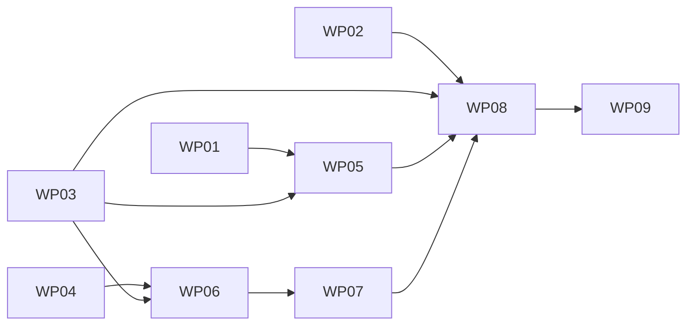

# Tasks: command-cli write core - canonical writer, lane authority and the lane-transition cut-over

**Mission**: events-write-core-01M6TP6W · **Planning branch**: `kitty/mission-events-write-core-01M6TP6W` (owned checkout, `single_branch` topology) · **Lands as**: one PR to `main` from `issue-160-write-core`, closing #160, #161 and #155 (operator ruling 1, C-005) · **Spec**: [spec.md](./spec.md) · **Plan**: [plan.md](./plan.md) · **Research**: [research.md](./research.md)

Implementation follows ATDD, red first. Each WP writes its acceptance tests before the code and runs them red for the right reason. The WPs follow the plan's Implementation Concern Map one to one. The parity corpus (WP04) is the acceptance oracle of WP06 and WP07; the `status_append` fixtures (WP01) are the acceptance oracle of WP05 and of WP08's byte checks.

## Subtask Index

| ID | Description | WP | Parallel |
|---|---|---|---|
| T001 | `status_log.sanitize_status_row`: PII strip at every depth, top-level session pair → `session_duration_s` | WP01 | |
| T002 | `status_log.encode_status_row`: sorted-key `json.dumps` bytes plus one LF; non-finite and mixed naive/aware refusals | WP01 | |
| T003 | `status_append` family scaffolding: README, `valid/`, `invalid/`, manifest entries, loader, special type, package data (both new families) | WP01 | |
| T004 | The fixture cases: ≥ 12 valid (one per sanitizer branch, escaping class, number kind), ≥ 4 invalid | WP01 | |
| T005 | Packaged `conformance/test_status_append.py` and the unit tests of `status_log` | WP01 | |
| T006 | Test-only generator `scripts/conformance/generate_status_append.py` with `--check` | WP01 | |
| T007 | `MissionLockPath` and the typed exceptions (`TornTailException`, `StatusLockHeldException`, `PersistenceFailedException`) | WP02 | [P] |
| T008 | `StatusLogAppender.withMissionLock`: bounded lock, locked session, current bytes, torn-tail refusal | WP02 | |
| T009 | `StatusLogSession.appendAndSync`: one `O_APPEND` write, force, parent-dir sync on create, truncate rollback, `FileOps` seam | WP02 | |
| T010 | Fault-injection tests (NFR-006, ≥ 100 iterations, fault-injecting channel) | WP02 | |
| T011 | `EventLogBoundaryTest`: the fourth package, its rule, event-log file-write ownership, planted violations | WP02 | |
| T012 | Native `reachability-metadata.json`: the `open`, `flock`, `close` downcalls | WP02 | [P] |
| T013 | `StatusLogInteropTest` against core's Python status writer, wired into the `lock-interop` job (SC-005) | WP02 | |
| T014 | Contract: `WriteOperation.yaml`, optional `TransitionUnit.operation`, example, `enum_pins.json` | WP03 | [P] |
| T015 | Contract: the description widenings of the delta and the `1.0.1-SNAPSHOT` CHANGELOG entries | WP03 | |
| T016 | `RefusalCode` gains every domain code the write path answers; `RefusalBody` gains optional `type` | WP03 | |
| T017 | `PyIsoDateTime` in domain-model: Python `datetime.fromisoformat` at core's pinned interpreter | WP03 | [P] |
| T018 | `WriteBodies` returns a typed `WriteRequest` (units, operation, rows as Python-JSON value trees, context) | WP03 | |
| T019 | Row rules at the edge: row kinds (FR-027), lane aliases (FR-023), non-finite numbers and unsubtractable session pairs (FR-028) | WP03 | |
| T020 | Parity case schema `case.schema.json` and the corpus README | WP04 | |
| T021 | Generator: materialize temporary Missions and call core's real entry points at the pin | WP04 | |
| T022 | Generator: exception → `(code, reason, message)` mapping, determinism, `--check` | WP04 | |
| T023 | The committed `core` corpus, meeting NFR-002's coverage counts | WP04 | |
| T024 | Hand-written `oracle: protocol` cases: stale `from_lane`, aliases, replay ordering | WP04 | |
| T025 | Packaged Python test: schema validation and NFR-002 coverage counts | WP04 | |
| T026 | CI job `write-core-parity` in `service.yml`, `service-gate` needs, detect paths, workflow tests | WP04 | |
| T027 | Python float repr port (shortest round trip, thresholds, signed zero) | WP05 | |
| T028 | `StatusRowEncoder`: separators, ASCII escaping with surrogate pairs, code-point key order, LF | WP05 | |
| T029 | `StatusRowSanitizer`: PII recursion, session pair through `PyIsoDateTime`, refusals | WP05 | |
| T030 | `StatusAppendFixtureTest`: the Java runner over every `status_append` case | WP05 | |
| T031 | Encoder and sanitizer unit tests, complexity and coverage | WP05 | |
| T032 | `WriteFold`: core's `read_events` rules, first-wins dedupe, ordering, annotation deltas → `WpWriteState` | WP06 | |
| T033 | `LaneMachine`: 11 lanes, 29 edges, terminals, force semantics (any target but `genesis`) | WP06 | |
| T034 | `Guards` with exact precedence and messages; `GuardContext` and its derived inputs (FR-022, no dependencies) | WP06 | |
| T035 | Pipeline guards (done evidence, unnoted review-lane force exit), stale `from_lane`, unknown lane | WP06 | |
| T036 | `UnitJudge`, `Refusal`, `Judgement`, and the `DependencyGate` / `ClaimGate` seams | WP06 | |
| T037 | ArchUnit: `domain.authority` is framework-free, I/O-free and concurrency-free, with planted violations | WP06 | [P] |
| T038 | `ParityCorpusTest` over the gate-free areas, with the explicit WP07-owned area list | WP06 | |
| T039 | `DependencyVerdict` (FR-013) behind `DependencyGate` | WP07 | |
| T040 | `ClaimRules` for `start_implementation`: actor compatibility, generic placeholders, implementer of record | WP07 | |
| T041 | `ClaimRules` for `start_review` and `start_rejected`, lifecycle force rules | WP07 | |
| T042 | `BatchJudge` sequencing across work packages and the `Authority` assembly | WP07 | |
| T043 | Full-corpus runner green; FR-012 reason reachability ledger | WP07 | |
| T044 | `WriteService` (FR-026 order) behind `MissionCatalog`, `StatusLog`, `RowCodec`; `WriteOutcome` | WP08 | |
| T045 | `adapter.out.mission`: root checkout from the gcd, `meta.json` scan, tasks lookup, SnakeYAML frontmatter → `MissionFacts` | WP08 | |
| T046 | `adapter.out.statuslog`: the event-log appender and codec behind the ports | WP08 | |
| T047 | Replay classification, `AckBody`, `WriteController` wiring, `WriteGate` removed | WP08 | |
| T048 | One fair in-process turn and the shared 10 s deadline (`SERVICE_BUSY`, `STATUS_LOCK_HELD`) | WP08 | |
| T049 | command-cli ArchUnit file-write ownership (FR-010) with allowlist and planted violation | WP08 | [P] |
| T050 | `WriteIntegrationTest` over HTTP (US1 to US5) and `WriteBenchmarkTest` (NFR-001) | WP08 | |
| T051 | Native: smoke test with a real locked write, `Enable-Native-Access`, build wiring | WP08 | |
| T052 | `service/command-cli/README.md`: the write core as built | WP09 | [P] |
| T053 | `docs/architecture/services/*`: protocol, lock and append, writers and readers, research outcome note | WP09 | |
| T054 | `service/README.md` and `docs/guides/service-protocol-and-releases.md`: the fail-closed wording retired | WP09 | |
| T055 | Contract CHANGELOG final pass | WP09 | |
| T056 | Changelog fragment(s) and the docs and changelog gates | WP09 | |

## WP01 - Python reference encoder and the `status_append` fixtures

Prompt: [tasks/WP01-python-reference-encoder.md](./tasks/WP01-python-reference-encoder.md). Priority P1. Wave 1. Dependencies: none. Profile: python-pedro.

Summary: a public `spec_kitty_events.status_log` module that sanitizes and encodes a status row exactly as core's `store._serialize` does at the pin, a new `status_append` conformance family with byte-exact expected lines, the packaged runner, and a test-only generator that re-derives every expected line from core and diffs it in CI (FR-001 to FR-003, FR-028 fixtures, NFR-003).

T001 sanitize_status_row (WP01)
T002 encode_status_row (WP01)
T003 status_append family scaffolding (WP01)
T004 Fixture cases (WP01)
T005 Packaged runner and unit tests (WP01)
T006 Test-only generator (WP01)

Risks: `datetime.fromisoformat` differs between Python 3.10 and 3.11+; the reference must reproduce core's pinned interpreter, not the running one. Core's default `json.dumps` writes `NaN`; the protocol refuses it (deliberate parity exception, research §11.9).

## WP02 - event-log status-log appender

Prompt: [tasks/WP02-status-log-appender.md](./tasks/WP02-status-log-appender.md). Priority P1. Wave 1. Dependencies: none. Profile: java-jenny.

Summary: a new event-log package `adapter.out.statuslog` that takes the per-Mission status lock with core's semantics, refuses a torn tail, writes bytes in one `O_APPEND` write plus a sync, syncs the parent directory on create and truncates back on failure; its own ArchUnit rule; the native downcall metadata; fault-injection tests; and an interop test against core's real Python status writer in the `lock-interop` job (FR-004 to FR-007, FR-010 event-log half, FR-028 rollback, NFR-006, SC-004, SC-005).

T007 Lock path and typed exceptions (WP02)
T008 Locked session and torn tail (WP02)
T009 Append, sync, rollback, FileOps (WP02)
T010 Fault injection (WP02)
T011 Boundary test (WP02)
T012 Native metadata (WP02)
T013 Status-log interop (WP02)

Risks: a short `FileChannel.write`; rollback that itself fails; the `lock-interop` result-count step counts JSON files and must not be disturbed; `service.yml` is WP04's file (one declared out-of-map edit to the `lock-interop` block).

## WP03 - Contract `operation` and the typed write edge

Prompt: [tasks/WP03-contract-and-typed-edge.md](./tasks/WP03-contract-and-typed-edge.md). Priority P1. Wave 1. Dependencies: none. Profile: java-jenny.

Summary: the additive `1.0.1-SNAPSHOT` contract delta (optional `operation`, widened descriptions), the domain refusal codes with their statuses and titles, `type` on the refusal body, a Python-`fromisoformat` port in domain-model, and a `WriteBodies` that returns a typed `WriteRequest` and refuses wrong row kinds, lane aliases, non-finite numbers and unsubtractable session pairs (FR-023 alias, FR-024 field, FR-027, FR-028 input, C-008). The existing edge tests stay green.

T014 WriteOperation and TransitionUnit.operation (WP03)
T015 Description widenings and CHANGELOG (WP03)
T016 RefusalCode and RefusalBody type (WP03)
T017 PyIsoDateTime (WP03)
T018 Typed WriteRequest (WP03)
T019 Row rules at the edge (WP03)

Risks: the contract tools (enum pins, examples, provisional and breaking checks) must stay green; the edge order (FR-019) must not move.

## WP04 - Parity corpus, its generator and the drift job

Prompt: [tasks/WP04-parity-corpus.md](./tasks/WP04-parity-corpus.md). Priority P1. Wave 1. Dependencies: none. Profile: python-pedro.

Summary: the language-neutral case schema, a test-only generator that runs core's real entry points at the pin against materialized temporary Missions, the committed corpus (≥ 150 cases), hand-written `protocol` cases, the packaged shape-and-coverage test, and the `write-core-parity` CI job that re-runs both generators with `--check` (FR-015, NFR-002).

T020 Case schema and README (WP04)
T021 Materialize and call core (WP04)
T022 Mapping, determinism, --check (WP04)
T023 Committed core corpus (WP04)
T024 Protocol cases (WP04)
T025 Packaged shape and coverage test (WP04)
T026 write-core-parity CI job (WP04)

Risks: nondeterministic ids and timestamps in core's rows; a generator that reimplements core instead of calling it (a second authority); a CI job that leaks into release runs.

## WP05 - Java status-row encoder and sanitizer

Prompt: [tasks/WP05-java-encoder.md](./tasks/WP05-java-encoder.md). Priority P1. Wave 2. Depends on WP01 (the fixtures) and WP03 (`PyIsoDateTime` in domain-model). Profile: java-jenny.

Summary: `StatusRowSanitizer` and `StatusRowEncoder` in event-log's codec package, consuming `PythonJson` value trees and producing core's bytes; a Java runner over every `status_append` case (FR-001 to FR-003, SC-001).

T027 Python float repr (WP05)
T028 StatusRowEncoder (WP05)
T029 StatusRowSanitizer (WP05)
T030 Java fixture runner (WP05)
T031 Unit tests and quality (WP05)

Risks: borrowing `CanonicalJson`'s separators or raw UTF-8 by accident; UTF-16 versus code-point key order.

## WP06 - Write domain, part 1: fold, lane machine and guards

Prompt: [tasks/WP06-write-domain-fsm-guards.md](./tasks/WP06-write-domain-fsm-guards.md). Priority P1. Wave 2. Depends on WP03 (refusal codes, the domain-model dependency) and WP04 (the case schema and corpus). Profile: java-jenny.

Summary: the pure `domain.authority` package: a write fold that ports core's `read_events` and reducer at the pin (annotation deltas included), the ported lane machine and every guard with exact precedence and messages, the pipeline guards, the stale-`from_lane` protocol rule, the derived guard inputs except dependency readiness, the framework-free ArchUnit rule, and the Java parity runner over the gate-free areas (FR-011, FR-012, FR-016, FR-022, FR-023, FR-025).

T032 WriteFold (WP06)
T033 LaneMachine (WP06)
T034 Guards and GuardContext (WP06)
T035 Pipeline guards, stale from_lane, unknown lane (WP06)
T036 UnitJudge and the gate seams (WP06)
T037 Purity rule (WP06)
T038 ParityCorpusTest (WP06)

Risks: reusing `StatusReducer` (forbidden by C-010 and research §11.8); guard precedence (research §10 risk 10).

## WP07 - Write domain, part 2: dependencies, claims and batches

Prompt: [tasks/WP07-write-domain-deps-claims-batch.md](./tasks/WP07-write-domain-deps-claims-batch.md). Priority P1. Wave 3. Depends on WP06 (and transitively WP03, WP04). Profile: java-jenny.

Summary: the dependency verdict, the lifecycle claim rules for `start_implementation` and `start_review`, batch sequencing across work packages, the `Authority` assembly, and the full corpus green with every one of the 15 reasons reached or recorded as unreachable (FR-012, FR-013, FR-014, FR-022, FR-024, SC-002).

T039 DependencyVerdict (WP07)
T040 Implementation claim rules (WP07)
T041 Review claim rules and start_rejected (WP07)
T042 BatchJudge and Authority (WP07)
T043 Full corpus and reason ledger (WP07)

Risks: core's zero-event idempotent starts; splitting a compact actor instead of reading the annotation-folded role.

## WP08 - Cut-over: WriteService, adapters, acks and serialization

Prompt: [tasks/WP08-write-service-cut-over.md](./tasks/WP08-write-service-cut-over.md). Priority P1. Wave 4. Depends on WP02, WP03, WP05, WP07. Profile: java-jenny.

Summary: the `WriteService` use case in FR-026 order behind three ports, the mission and status-log adapters, replay classification, the contract acks, the in-process turn with the shared 10 s deadline, `WriteGate` removed, the command-cli file-write ownership rule, HTTP integration tests for every scenario of US1 to US5, the NFR-001 benchmark and a native smoke that performs a real locked write (FR-006 smoke, FR-008, FR-009, FR-010, FR-017 to FR-020, FR-026, NFR-001, SC-003).

T044 WriteService and ports (WP08)
T045 Mission catalog adapter (WP08)
T046 Status-log adapter (WP08)
T047 Replay, acks, controller, WriteGate removed (WP08)
T048 Turn and deadline (WP08)
T049 File-write ownership rule (WP08)
T050 Integration tests and benchmark (WP08)
T051 Native smoke and native access (WP08)

Risks: replay judged after authority (breaks retries); a lock held across the HTTP answer; FFM native access missing in the jar or the image.

## WP09 - Documentation, contract CHANGELOG pass and changelog fragment

Prompt: [tasks/WP09-docs-and-changelog.md](./tasks/WP09-docs-and-changelog.md). Priority P2. Wave 5. Depends on WP08. Profile: scribe-sally.

Summary: the service README, the services architecture pages, the guide, the contract CHANGELOG final pass and the changelog fragment describe the write core as built; the docs and changelog gates pass (FR-021, C-007).

T052 command-cli README (WP09)
T053 Architecture pages (WP09)
T054 Service README and guide (WP09)
T055 Contract CHANGELOG pass (WP09)
T056 Changelog fragment and gates (WP09)

Risks: describing planned behaviour instead of shipped behaviour; a frontmatter `description` over 180 characters; a fragment link written with `../`.

## Dependency graph

Two edges are added to the plan's graph, both inside the same waves. WP06 depends on WP03 as well as WP04: its `Refusal` carries the `RefusalCode` values WP03 adds, and it builds on the domain-model dependency WP03 adds to command-cli (the plan routes that through WP03 → WP07). WP05 depends on WP03 as well as WP01: its sanitizer parses the session pair with the `PyIsoDateTime` port WP03 adds to domain-model, so the edge (WP03) and the encoder (WP05) share one port of Python's `fromisoformat`.

## Coordination points (shared files and declared out-of-map edits)

| File | Owner | Declared out-of-map edit |
|---|---|---|
| `.github/workflows/service.yml`, `tests/test_service_workflows.py`, `tests/test_ci_gate_workflows.py` | WP04 | WP02 edits only the `lock-interop` job block (run step and result check) |
| `service/command-cli/build.gradle.kts` | WP08 | WP03 adds `implementation(project(":domain-model"))` only |
| `service/command-cli/.../operations/OperationsTest.java` | WP08 | WP03 adds lane fields to the two minimal-row bodies that must still reach the gate |
| `service/command-cli/.../operations/WriteBodies.java` | WP03 | WP08 may delete the `Optional<Malformed>` delegates once the controller uses the typed parse |
| `contracts/mission-write/CHANGELOG.md` | WP03 | WP09's final pass |
| `src/spec_kitty_events/conformance/loader.py`, `fixtures/manifest.json`, `pyproject.toml` | WP01 | none: WP01 adds the package-data globs of both new families; the corpus is loaded by WP04's own `parity_corpus.py`, not through the manifest |
