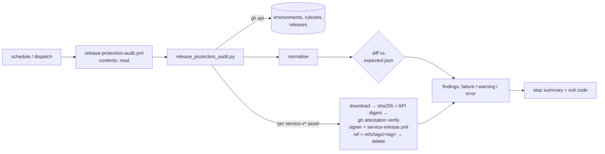

# Implementation Plan: Release-protection posture for the service-v* line

**Branch**: `issue-239-release-protection` (single branch; one PR to `main`) | **Date**: 2026-11-11 | **Spec**: [spec.md](./spec.md)
**Input**: Mission specification `kitty-specs/release-protection-posture-01M74ZWP/spec.md` (#239, closes #221)

## Summary

Add a scheduled, read-only release-protection audit:

- `.github/workflows/release-protection-audit.yml`: `schedule` + `workflow_dispatch` only, `contents: read`, one SHA-pinned action (`actions/checkout`).
- `scripts/release/release_protection_audit.py`: a stdlib-only Python script. It reads the live settings and releases through `gh api`, compares the normalised settings with `scripts/release/release-protection-expected.json`, and checks each `service-v*` release's author and each asset's provenance with `gh attestation verify`. Its checks are pure functions over JSON plus an injected asset verifier, so the tests drive them from captured fixtures.
- Tests: `tests/test_release_protection_audit.py` covers the workflow's shape (AC 1), the expected-file comparison including a mutate-every-leaf check (AC 2) and the release rules (AC 3). The new test file also runs actionlint on the new workflow (when actionlint is installed), so `tests/test_service_workflows.py` is untouched.
- Docs: a "Release-protection posture" section in `docs/guides/service-protocol-and-releases.md` with the vector → control / accepted-risk table and the operator's sign-offs (AC 4), plus a changelog fragment and the header/workflow-list mentions (FR-015).

No repository setting changes (C-001), no change to `ci-pr-lane-canary.yml` (D7) or the `main` ruleset (D5).

## Technical Context

**Language/Version**: Python 3.10+ (stdlib only; the runner's `python3` is 3.12), GitHub Actions YAML
**Primary Dependencies**: `gh` CLI preinstalled on GitHub-hosted runners (`gh api --paginate`, `gh release download`, `gh attestation verify`); `actions/checkout@08c6903cd8c0fde910a37f88322edcfb5dd907a8 # v5.0.0` (already pinned in `service-release.yml`). No new Python or Gradle dependency.
**Storage**: a committed JSON file (`scripts/release/release-protection-expected.json`); test fixtures under `tests/fixtures/release_protection/`
**Testing**: pytest (+ PyYAML already in the dev group), ruff, mypy --strict on the new script; actionlint through the existing test
**Target Platform**: GitHub-hosted `ubuntu-24.04` runner; the tests run anywhere (no network)
**Project Type**: single project (repository tooling: workflow + script + docs)
**Performance Goals**: audit ≤ 20 min wall clock (NFR-001), job timeout 30 min; peak extra disk ≤ largest asset + 50 MB (NFR-004)
**Constraints**: `contents: read` only (FR-002, C-004); deterministic output (NFR-002); fail closed on any API error (FR-010)
**Scale/Scope**: 4 environments, 2 rulesets, 2 `service-v*` releases (44 assets, ~1.2 GB) at merge, growing by one release per tag

## Charter Check

| Charter rule | Status |
|---|---|
| Quality Gates: SHA-pinned actions in any workflow added or changed (ADR 0003, NFR-003) | Met: the one action is SHA-pinned with a version comment; FR-003's test enforces it. |
| Quality Gates: pytest, mypy --strict | Met: new tests; the script is typed and checked with `mypy --strict`. |
| Deployment Constraints: service releases carry sha256 and build provenance | Strengthened: the audit checks provenance on the published side. |
| Project Directive 2: keep documentation synchronized | Met: guide, AGENTS.md/CLAUDE.md workflow list, `service-release.yml` header. |
| Package Boundary: no dependency on core | Met: no core code or checkout. |
| Event-contract review policy | Not applicable: no envelope, payload, schema or fixture of the event contract changes. |
| Exception Policy | No exception requested. D5–D8 are recorded rulings, not charter exceptions. |

Post-design re-check: unchanged, no gaps.

## Project Structure

### Documentation (this mission)

```
kitty-specs/release-protection-posture-01M74ZWP/
├── spec.md
├── plan.md            # this file
├── research.md        # spike record and design decisions
├── data-model.md      # normalised settings, findings
├── quickstart.md      # run / read / update the audit
├── contracts/
│   └── audit-cli-and-expected-settings.md
└── tasks.md           # /spec-kitty.tasks
```

### Source Code (repository root)

```
.github/workflows/release-protection-audit.yml      # new (WP02)
.github/workflows/service-release.yml               # header comment only (WP02)
scripts/release/release_protection_audit.py         # new (WP01)
scripts/release/release-protection-expected.json    # new (WP01)
tests/test_release_protection_audit.py              # new (WP01 checks, WP02 workflow-shape tests)
tests/fixtures/release_protection/                  # new: captured live settings + releases (WP01)
docs/guides/service-protocol-and-releases.md        # new section (WP03)
AGENTS.md, CLAUDE.md                                # workflow list mention (WP02)
docs/changelog/unreleased/239-release-protection-audit.md   # fragment (WP03)
```

**Structure Decision**: release tooling lives beside `service-release-assets.sh` in `scripts/release/`; the expected-settings file sits next to the script that reads it, so a reviewer sees both in one place. Tests import the script the way `tests/test_sonar_java_modules.py` imports `scripts/sonar_java_modules.py`.



## Implementation Concern Map

| Concern | FRs / NFRs | WP |
|---|---|---|
| Settings normalisation, diff, expected file, fixtures, AC 2 test | FR-004, FR-005, FR-006, NFR-002 | WP01 |
| Release provenance checks, prerelease rule, error handling, summary, AC 3 tests | FR-007–FR-011, NFR-004 | WP01 |
| Audit workflow, AC 1 tests, actionlint, header and workflow-list mentions | FR-001–FR-003, FR-015, NFR-001 | WP02 |
| Guide section (vector table, sign-offs, how to run/read/update), changelog fragment | FR-012–FR-014 | WP03 |

## Complexity Tracking

None: no charter violation.

## Parallel Work Analysis

### Dependency Graph

WP01 → WP02 → WP03 (single branch, sequential). WP02 needs the script's CLI; WP03 names the workflow, script and expected file.

### Work Distribution

- **Sequential work**: all three WPs, on `issue-239-release-protection`.
- **Agent assignments**: WP01 (security logic) on a Sonnet-class implementer; WP02 (mechanical YAML + tests) on a cheaper model; WP03 (docs, changelog) on Haiku. Each WP gets an independent review before approval.

### Coordination Points

- Sibling sessions A (#237) and C (#170) touch none of these files (confirmed with the orchestrator, 2026-11-11). No existing test file changes.
