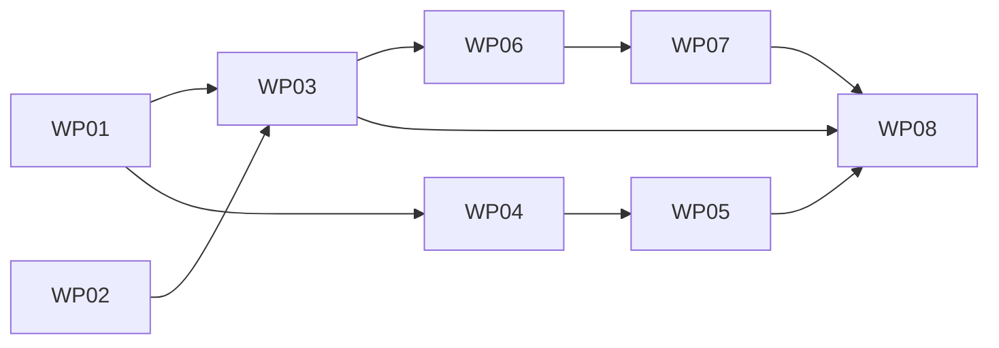

# Implementation Plan: Write-service cut-over readiness

**Branch**: `kitty/mission-write-service-cutover-readiness-01M70THX`, landing as `issue-236-write-service-cutover-readiness` → `main` | **Date**: 2026-11-09 | **Spec**: [spec.md](./spec.md)
**Input**: [spec.md](./spec.md), [research.md](./research.md), [research/brownfield-scout.md](./research/brownfield-scout.md) (seam map at events `62af21d0`, core `main` @ `366ff233`, pin `512567ee`)

## Summary

This mission makes the events write service ready to be the only status-log writer before core #6195 lands. It adds four things:

- **Repair.** An explicit, locked status-log repair operation (`POST /missions/{missionId}/status-log-repairs`, actions `none`/`completed`/`quarantined`; D1, D2).
- **Evidence flag.** An optional, request-only `implementationEvidencePresent` on `TransitionUnit` (D3).
- **Real root.** The resolved root replaces the fabricated `<root>` in the guard context, and the docs say why `workspace_context_required` is wire-unreachable.
- **Hardening.** A drain-aware wait (D10), catch-all logging without content, `x-provisional` on `WriteOperation`, and the read-back step in the docs.

The design is split along the existing architecture rules:

- **Event-log.** File IO (quarantine, truncate, force, directory sync) lives in event-log's `adapter.out.statuslog`. That is the only place allowed to write status logs (`EventLogBoundaryTest`, `WriteOwnershipRulesTest`).
- **Command-cli.** The *decision* (is the fragment one readable row?) and the transport live in command-cli, because statuslog may not depend on the row codec.

## Technical Context

**Language/Version**: Java 25 (services; Gradle Kotlin DSL), Python 3.10+ (package, conformance corpus, contract tools)
**Primary Dependencies**: Spring Boot (command-cli HTTP edge), JUnit 5 + ArchUnit + AssertJ, GraalVM native image (no new reflection: the new ack serialises as an ordered map, like `AckBody`); pytest + jsonschema for the corpus and the contract tools. **No new dependency** in any ecosystem (DIRECTIVE_051: nothing to assess).
**Storage**: the Mission's `status.events.jsonl` and the new `status.events.jsonl.torn` beside it, under the per-Mission `flock` `<gcd>/spec-kitty-locks/<dir>.status.lock` shared with core.
**Testing**:
- **Java:** `./gradlew :event-log:check :command-cli:check` (plus `verifyAll` for the contracts module), with fault injection through `FileOps` fakes and HTTP through `WriteRig`/`EdgeRig`.
- **Python:** `uv run pytest tests/test_generate_transition_parity.py` and `uv run pytest --pyargs spec_kitty_events.conformance`.
- **Contract tools, run by hand** (not CI gates, #151): `breaking_check.py`, `citation_check.py`, `provisional_check.py`, `layout_check.py`, `structure_check.py`.
**Target Platform**: Linux/macOS/Windows resident service (JVM and native image), localhost only.
**Project Type**: multi-module Gradle build plus a Python package (existing layout).
**Performance Goals**: a repair reads the log once and folds it at most once (NFR-006). A waiting request answers within 1 s of drain start (NFR-004).
**Constraints**:
- The launcher contract is unchanged (5 s drain, SIGTERM at 10 s; D10).
- No new refusal code: core's client parses `WriteRefusalCode` as a closed enum.
- Contract changes are additive inside `1.0.1-SNAPSHOT`.
- Complexity is at most 15.
**Scale/Scope**:
- **Code:** about 8 Java production classes touched or added, about 10 test classes.
- **Contract:** 1 path file, 2 schemas, 5 contract files edited.
- **Corpus:** 2 or more new corpus cases.
- **Docs:** 5 doc files.

## Charter Check

| Charter rule | Status |
|---|---|
| Contract or fixture change gets a deliberate compatibility review (Branch Strategy, Review Policy) | Pass. Additive only; break check run and recorded (WP01). The corpus change is reviewed in WP04. |
| Every binding passes the shared conformance fixtures | Pass. New corpus cases run in the Python packaged gate and in the Java `ParityCorpusTest`/`ProtocolCorpusTest`. |
| ArchUnit onion and boundary rules mandatory | Pass. The repair splits along `EventLogBoundaryTest` and `WriteOwnershipRulesTest`; no rule is relaxed (C-002). |
| No core dependency at build or run time (Services, Package Boundary) | Pass. Core only through the test-only pin (the corpus generator's `--check`). |
| Strict Gradle dependency verification, SHA-pinned actions | Pass. No dependency or workflow change. |
| Docs synchronised with behaviour (Directive 2) | Pass. WP08. |
| `mypy --strict`, ruff, conformance gate | Pass, if the WP04 generator and packaged-test changes stay typed. |

Re-checked after design: no violation, so no Complexity Tracking entry.

## Design

### D-A. Repair: event-log primitive (WP02)

- **Port.** Extend event-log's `StatusLogSession` with `TailRepair repairTail(TailClassifier classifier)`, run **inside the existing `StatusLogAppender.withMissionLock`**. Reusing it means the same `MissionLockPath`, the same deadline and the same `StatusLockHeldException`. No second lock path, and not `TornTailRepair`'s `<ledger>.lock`.
- **Reading.** `LockedStatusLogSession` reads the raw bytes (a missing file reads as empty), without `readAndCheckTail`. `currentBytes()` keeps refusing a torn tail (C-001).
- **Classification.**
  - When the bytes are empty or end in LF, the action is `NONE` and nothing is touched.
  - Otherwise `fragment = bytes after the last LF`, and the callback `TailClassifier.isCompleteRow(byte[] fragment)` answers. The decode lives in command-cli (boundary rule).
- **`COMPLETED`.** Write `"\n"` to the log channel, then `force`.
- **`QUARANTINED`**, in this order:
  1. open `status.events.jsonl.torn` for append (create, NOFOLLOW) through `FileOps.openForAppend`;
  2. write `fragment + "\n"`, then `force`;
  3. sync the directory if the quarantine file is new;
  4. truncate the log to `lastLf + 1`, then `force`;
  5. sync the directory.

  A failure before step 4's `force` leaves the log byte-identical: the truncate is the last mutation. If step 4 throws after the truncate but before the `force`, the fragment is already durable in quarantine. The outcome reports `PersistenceFailed`.
- **Result.** `TailRepair` carries `{action, movedBytes, bytesAfter}`. `bytesAfter` lets command-cli fold without a second read.
- **`FileOps`.** Prefer reusing `read`, `openForAppend`, `AppendChannel.truncate/force` and `syncDirectory`. If a new method is unavoidable, update `StatusLogFaultInjectionTest.FaultyFileOps` in the same commit, and add any new public type to `EventLogBoundaryTest.STATUSLOG_TYPES`.
- **Tests:**
  - Each action.
  - The fault matrix (NFR-001): fail each of the write, force, truncate and directory-sync steps in turn, and assert either the original log, or the log at its last LF with the fragment in quarantine.
  - An existing quarantine file is appended to, never overwritten.
  - Lock held, giving `StatusLockHeldException`.
  - A regression test that `appendAndSync` still refuses a torn tail.

### D-B. Repair: command-cli operation (WP03)

- **Application.** `application/repair/StatusLogRepairService`:
  - the surface check plus `MissionCatalog.find` and `locationMatches`, exactly as `WriteService` does (shared via a small extracted helper, not a copy);
  - the turn, the shared `budget` deadline, then `statusLog.withLock(...)` running `session.repairTail(classifier)`;
  - mapping `LockResult` as a write does.
- **Classifier.** It uses the write path's read-back strictness: `codec.decode(fragment + "\n")` yields exactly one row, and that row decodes as a status row the fold accepts. Reuse `AppendVerifier`'s decode step.
- **`readableAfterRepair`.** `codec.decode(bytesAfter)` plus `WriteFold.fold` succeeds (`false` on `UnreducibleLog` or a decode error). It is computed inside the lock, from the bytes the repair left.
- **Port.** The command-cli `StatusLog.Session` gains `repairTail(...)`, and `EventLogStatusLog` adapts it.
- **HTTP.** A `@RestController` in `adapter.in.http.operations` (a sibling of `WriteController`):
  - the draining check (503), `@RequestBody byte[]` parsed into a closed `{context: RequestContext}` (unknown member → 400), and the catch-all;
  - an answer of `200` with an ordered-map body `{repaired, action, movedBytes, quarantinedFile, readableAfterRepair}`.
- **Edge.** `Operations.needsProtocol` learns the path. The body cap and `ActivityFilter` already apply to every path.
- **Tests (HTTP through `WriteRig`, extended):**
  - every acceptance scenario of User Story 1;
  - a concurrency test (repair plus write threads, serialised, never interleaved);
  - `OperationsTest`, `EdgeOrderTest` and contract-schema validation of the answer (`ContractSchemas.violations`).

### D-C. Evidence wire field (WP04)

- **Parsing.** `WriteBodies` adds `implementationEvidencePresent` to `UNIT_FIELDS` (boolean or null, anything else is `400`) and updates the enumerated detail text at :141.
- **Domain.**
  - `WriteRequest.UnitRequest` and `UnitInput` gain `Boolean implementationEvidencePresent`. Keep the old constructors as delegating overloads, so no intermediate commit is red at the 10 call sites.
  - `UnitJudge` passes it to `Guards.context`.
  - The evidence is the supplied value when present (non-null) and `from == IN_PROGRESS && to == FOR_REVIEW`; otherwise today's `wp.hasTransitions()`.
  - The subtask derivation is untouched.
- **Replay.** `ReplayClassifier` is unchanged: it compares encoded rows only.
- **Corpus:**
  - `case.schema.json` allows the key on wire units.
  - The generator (`generate_transition_parity.py`) learns an `implementation_evidence_present` core-call kwarg (`ROW_CALL_KWARGS`) and emits it on wire units (:1888/:1906).
  - New cases are generated **against the core pin**: refusal with `false` (complete roster), acceptance with `true`, acceptance when absent, and `true` with an incomplete roster (still refused for subtasks).
  - `unreachable.json` drops `partial`.
- **Java consumers:**
  - `ProtocolCorpusTest.requestBody` copies the key.
  - `everyGuardReasonOverHttp` keeps a subtask-half representative: choose the representative deterministically (for example, prefer cases without the new key), or run every guard case. Do not let the new case silently displace the subtask case.
  - The `PASSED` count is updated.
  - `ParityCorpusTest` and `CorpusCases` build `UnitInput` with the field.
- **Packaged test.** `test_status_transition_parity.py`'s reachability algebra stays green with `partial` absent.

### D-D. Real root in the guard context (WP05)

- **Root.** The resolved root checkout (`FilesystemMissionCatalog.root()`, resolved once in `ServiceWiring`) travels as a `String` through `MissionFacts`. That is the smallest port change, since `Guards` is pure domain. `Guards.context` builds `executionMode + ":" + root`.
- **Fallback.** When no root resolves, the write is already refused earlier (`RootUnverifiable`), so there is no `<root>` fallback.
- **Tests:**
  - `GuardContextTest` asserts the real root, not `"<root>"`.
  - A byte test shows no encoded row changes.

### D-E. Drain-aware wait (WP06, D10)

- **Signal.** A `BooleanSupplier draining` (from `ServiceLifecycle::draining`) is wired into `WriteService` and `StatusLogRepairService`.
- **Turn.** `WriteTurn.tryAcquire` waits in slices of at most 50 ms. Between slices it checks `draining`, and on drain it answers "abandoned". A sliced `tryLock` re-enters the fair queue each slice. That is acceptable: ordering among waiters is not a contract, and it only matters while the service is draining.
- **Mission lock.** `StatusLog.withLock` gains the abandon signal, passed to event-log's `StatusLogAppender.withMissionLock` and then `LedgerLock.acquire`, which checks it on each 100 ms poll.
- **New outcome.** A new `LockResult.Abandoned` variant maps to `503 SERVICE_DRAINING`, with no `Retry-After` and nothing written.
- **Unchanged.** A request already holding the lock is not interrupted. The 5 s `DRAIN_BUDGET` and `LAUNCHER.md` are unchanged; the `SERVICE_DRAINING` description gains "also a request that was still waiting when draining began".
- **Tests:**
  - `DrainTest` with a real write blocked on an externally held Mission lock: `POST /shutdown`, then the write answers `503 SERVICE_DRAINING` within 1 s, the log is unchanged, and the drain completes within 5 s.
  - A write holding the lock completes and gets `201`.
  - Unit tests for the abandon path in `LedgerLock` and `WriteTurn`.

### D-F. Catch-all logging (WP07)

- **Logger.** `System.Logger` at `WARNING` in `WriteService.write`, `WriteController` and the repair service and controller catch-alls.
- **Record.** `"<operation> failed with <CODE>: <exception class chain>"`, with the class names of the cause chain only and no messages (JDK I/O messages carry host paths).
- **Tests:**
  - A JUL `Handler` on the class's logger captures exactly one record per injected failure.
  - A marker test plants a path, a token-like string and a row value in the request and in the exception message, and asserts none appears in any captured record (NFR-003).

### D-G. Contract (WP01)

- **New files:**
  - `paths/missions_missionId_status-log-repairs.yaml`;
  - `schemas/StatusLogRepairRequest.yaml` (closed: `context`);
  - `schemas/StatusLogRepairAck.yaml` (closed: `repaired`, `action` enum `none|completed|quarantined`, `movedBytes`, `quarantinedFile` const `status.events.jsonl.torn` or null, `readableAfterRepair`);
  - the `openapi.yaml` path entry and the `schemas/_index.yaml` entries.
- **Responses** of the new path: 200/400/401/403/404/409/413/422/500/503, reusing the response files.
- **Citations.** `x-derived` on every new property, with `inputs` citing the service symbols or core's `TransitionRequest.implementation_evidence_present` (core `models.py`).
- **`TransitionUnit.implementationEvidencePresent`**: `type: [boolean, 'null']`, optional, with `x-source` on core `src/specify_cli/status/models.py` `TransitionRequest.implementation_evidence_present`.
- **Other schema edits:**
  - `WriteOperation`: `x-provisional` with its open decision.
  - `WriteRefusalReason.workspace_context_required` and `implementation_evidence_required`: descriptions updated.
  - `WriteRefusalCode.REQUEST_MALFORMED`: names the read-back cases.
  - `responses/ServiceBusy.yaml`: the drain-aware wording.
  - `enum_pins.json` pins the new `action` enum.
- **CHANGELOG.** Bullets under `1.0.1-SNAPSHOT` (Added, Changed, Provisional).
- **Checks.** Run the five contract tools by hand and paste their output into the WP's review notes. The `contracts` Gradle `validate_*`/`validateBundle_*` tasks must pass.

### D-H. Docs and records (WP08)

- **`docs/architecture/services/event-log-lock-and-append.md:140-146`.** Repair lands **before** #6195, through the operation.
- **`service/command-cli/README.md`:**
  - the HTTP surface table (59-71), the check order (a read-back step between authority and append, 108-141), binding notes (236-254), unreachable reasons (285-289), drain (293-301);
  - remove the stale #6910 "bare paths" line (333-335).
- **`docs/architecture/services/write-service-protocol.md`:** steps (89-112), operations (225-238), unreachable reasons (216-223, with *why*), stop (287-291).
- **`docs/guides/service-cutover-runbook.md`.** A torn-tail stopgap: call the operation with the endpoint token until core's verb ships.
- **Changelog fragments** in `docs/changelog/unreleased/`: one per closed issue (#222, #223, #224, #231).
- **Prior mission record.** Add a #222 row to `kitty-specs/events-write-core-01M6TP6W/issue-matrix.json` (record-only).
- **Validation.** `cd site && npm run validate`, then `python3 scripts/docs_index.py --clean`.

## Work Packages and Sequencing

| WP | Title | Depends on | Implementer |
|---|---|---|---|
| WP01 | Contract: repair path and schemas, evidence field, wording, CHANGELOG | — | tokenfactory (kimi-k3, else deepseek-v4.1-flash) |
| WP02 | Event-log: locked tail-repair primitive with fault matrix | — | Claude Sonnet 5.5 (destructive durability) |
| WP03 | Command-cli: repair service, port, controller, HTTP tests | WP01, WP02 | Claude Sonnet 5.5 (destructive and concurrency) |
| WP04 | Evidence field: parsing, authority, corpus, generator | WP01 | Claude Sonnet 5.5 (parity) |
| WP05 | Real root in the guard context | WP04 | tokenfactory |
| WP06 | Drain-aware wait (D10) | WP03 | Claude Sonnet 5.5 (locking) |
| WP07 | Catch-all logging | WP06 | tokenfactory |
| WP08 | Docs, runbook, changelog fragments, records | WP03–WP07 | Claude Haiku 5.5 |



**Waves:** {WP01, WP02} → {WP03, WP04} → {WP05, WP06} → WP07 → WP08.

**Branching.** Each implementer works in an isolated worktree branched from the mission branch. The orchestrator merges each approved WP `--no-ff` into the mission branch, sequentially, before dependants start.

**Reviews.** Each WP review runs on Opus or Sonnet. Orchestrator-owned follow-ups (core issue, #6195 comment, #237 note) are filed alongside WP08.

## Testing Strategy

- **Red first.** Each defect (the `<root>` placeholder, the lost answer on drain, the silent catch-all) gets a failing test through the production entry point before the fix (ATDD). New behaviour gets acceptance tests over HTTP.
- **Non-vacuity.** Each negative assertion (byte-identical, nothing created, no marker in logs) is paired with a positive control on the same fixture (spec FR labels).
- **Blast radius, recorded in the PR:**
  - `./gradlew :event-log:check :command-cli:check :contracts:check`;
  - `uv run pytest tests/test_generate_transition_parity.py tests/test_service_workflows.py tests/test_docs_service_reference.py`;
  - `uv run pytest --pyargs spec_kitty_events.conformance`;
  - `ruff check . && ruff format --check .`;
  - `uv run python scripts/changelog.py check && … guard`;
  - `cd site && npm run validate`;
  - the five contract tools.

## Risks

| Risk | Mitigation |
|---|---|
| A destructive repair loses bytes | Quarantine before truncate, then the fault matrix (NFR-001) and a byte-identical healthy-log test |
| Repair races a write or core's writer | The same turn and the same Mission `flock` as a write, plus a concurrency test |
| The new corpus case displaces the subtask-half HTTP representative | Choose the representative deterministically (D-C) |
| Rolling upgrade: a new client meets an old service and gets `400` | Out of service scope. Documented on #6195 (FR-022) |
| A `service-v*` rc is cut before merge | The additions then open `1.0.2-SNAPSHOT` (the contract README rule). Re-check before the PR |
| Cross-repo whack-a-field (core client shapes) | Filed in the core follow-up (FR-022); no new refusal code |
| Contract tools are not CI gates | Manual run recorded in WP01 and again pre-PR |

## Project Structure

### Documentation (this mission)

```
kitty-specs/write-service-cutover-readiness-01M70THX/
├── spec.md, plan.md, research.md, data-model.md, quickstart.md
├── research/brownfield-scout.md
├── contracts/status-log-repair.md
├── decisions/ (D1–D4, D9, D10)
└── tasks.md, tasks/ (from /spec-kitty.tasks)
```

### Source Code (touched)

```
contracts/mission-write/{openapi.yaml, paths/, schemas/, responses/ServiceBusy.yaml, CHANGELOG.md}
contracts/tools/enum_pins.json
service/event-log/src/main/java/org/speckitty/missionstatus/adapter/out/statuslog/  (+ ledger/LedgerLock)
service/command-cli/src/main/java/org/speckitty/commandcli/{application/{write,repair,lifecycle}, adapter/{in/http,out/statuslog,out/mission}, domain/authority, config}
src/spec_kitty_events/conformance/status_transition_parity/{case.schema.json, cases/, unreachable.json}
scripts/conformance/generate_transition_parity.py
docs/architecture/services/, service/command-cli/README.md, docs/guides/service-cutover-runbook.md, docs/changelog/unreleased/
```

**Structure decision:** existing layout. Nothing new at module level; one new application package (`application/repair`).

## Branch contract (restated)

Current branch: `kitty/mission-write-service-cutover-readiness-01M70THX`. Planning/base branch: `main`. Merge target: `main`, via the PR branch `issue-236-write-service-cutover-readiness` (D9).

## Post-plan adversarial squad: folded findings (2026-11-09)

Two Opus lenses ran: durability and concurrency (renata), and contract, parity and scope (alphonso). Every finding is folded below and into the WP acceptance criteria. Where a point here contradicts the Design section above, **this section wins**.

### Durability and concurrency

- **[MAJOR] Classifier in context (D-A, D-B).**
  - The callback is `TailClassifier.isCompleteRow(byte[] prefix, byte[] fragment)`.
  - `completed` requires both: `decode(fragment + LF)` is exactly one row, and `WriteFold.fold(decode(prefix) ++ row)` succeeds.
  - Anything else is `quarantined`, including an unreducible prefix (the fragment is then quarantined and `readableAfterRepair` is `false`).
  - For `completed`, `readableAfterRepair` is `true` by construction (the fold already ran).
  - NFR-006 now allows at most two folds.
- **[MAJOR] Size re-check (D-A).**
  - Open the log channel first.
  - Require `channel.size() == bytesRead.length` before the first mutation, and again before the truncate or LF write. If it differs, the result is `PersistenceFailed` and nothing changes.
  - The fault matrix gains a "log changed after read" row (`FaultyFileOps` has `inconsistentRead`).
- **Directory sync.** Always run `syncDirectory(parent)` after the quarantine force and before the truncate, whether or not the file is new.
- **Partial writes.** Check every written count. On any failure before the truncate:
  - truncate `.torn` back to its starting size and force it (as `rollback` does);
  - for `completed`, roll back the 1-byte LF the same way.

  "Append-only" covers committed content.
- **FR-003 wording.** It now reads "before the truncate". The fault matrix expects these outcomes:
  - before the truncate: log byte-identical, `.torn` at its starting size, `500`;
  - after the truncate (failed force or failed directory sync): log at its last LF, fragment in `.torn`, `500`, and a re-run answers `none`.
- **Fault harness.** A new `FileOps` fake fails the Nth call. The test enumerates every call of a quarantine run and asserts NFR-001 at each N. `RecordingFileOps` (`StatusLogSessionTest.java:98`) and `FaultyFileOps` both implement any new `FileOps` method in the same commit.
- **Type of `.torn`.** `lstat` it without following links: it must be absent or a regular file. Otherwise the result is `PersistenceFailed` and nothing changes. Tests cover a dangling symlink, a live symlink, a directory and a FIFO (POSIX; skipped on Windows).
- **`readableAfterRepair` failures.** Catch any runtime exception from decode or fold and report `false`, never a `500` for a repair that is already done.
- **Runbook: torn multi-row unit.** The retry answers `409 EVENT_ID_CONFLICT`; re-issue the unit with new ids. An HTTP test pins this.
- **Shared turn.** `ServiceWiring` exposes one `WriteTurn`, one `StatusLog`, one `MissionCatalog` and one budget as beans, used by both `WriteService` and `StatusLogRepairService`. A test shows a repair waiting on a turn held by a write.
- **Abandon plumbing (D-E).**
  - `WriteTurn.tryAcquire` returns a three-state result: acquired, timed out (giving `SERVICE_BUSY` as today), or abandoned (giving `SERVICE_DRAINING`, no `Retry-After`).
  - Event-log adds `StatusLockAbandonedException`, listed in `STATUSLOG_TYPES` if public. `EventLogStatusLog` catches it **before** `IOException` and maps it to `LockResult.Abandoned`.
  - `LedgerLock` checks the abandon signal only after a failed `tryAcquire`, never once it holds the lock.
  - The abandon-aware `acquire` and `withMissionLock` are **overloads**, so `TornTailRepairTest.RecordingLock` and about 24 `withMissionLock` call sites stay untouched.
  - **Turn slicing:** first-come-first-served order among waiters is lost in normal operation too, not only while draining. That is accepted: waiter order is not a contract.
- **Drain test.** Add the repair path to `DrainTest`'s path list (:63), and a repair waiting on an externally held lock.
- **Logging (D-F).**
  - Tests hold a strong reference to the JUL logger and remove the handler in `finally`.
  - The class-chain walk stops on cycles (an identity set) and caps at depth 8, ignoring suppressed exceptions.
  - The catch-alls stay `RuntimeException`-only. An `Error` propagates to Spring's default handling, a deliberate choice recorded in the WP.
- **Constructor stability.**
  - `StatusLog.Session.repairTail` is a `default` method that throws `UnsupportedOperationException`, so `WriteServiceTest.FakeLog` stays green.
  - `withLock` gains an overload, not a signature change.
  - `LockResult.Abandoned` is added together with every exhaustive switch.
  - `WriteService` keeps its delegating constructors.
- **`.torn` and core's dirty-tree guards.** WP08 checks core's dirty-tree and auto-commit handling of an untracked file in a Mission directory and documents the outcome in the runbook.

### Contract, parity and scope

- **[MAJOR] Break check with a real baseline (WP01).**
  1. Run `uv run python contracts/tools/install_tools.py`.
  2. Run `breaking_check.py --root contracts --module mission-write --baseline-root <git archive origin/main>/contracts`.
  3. Accept only `BUNDLE_CHANGED_VERSION_SAME` and the `TransitionUnit.operation` removal caused by stripping `x-provisional` from `WriteOperation`. Anything else is a failure, including any other `BREAKING_WITHOUT_MAJOR` and any `response-key-added` on an existing path.
  4. The `### Provisional` bullet records that `operation` leaves break coverage; `enum_pins.json` still guards it.
- **[MAJOR] Citations (WP01).**
  - New properties cite contract-field `x-derived` inputs, or core Python symbols (for example core `src/specify_cli/status/store.py` `append_raw_rows_atomic`, and `src/specify_cli/status/models.py` `TransitionRequest`). Never events' Java.
  - Invocation: `citation_check.py --module mission-write --repo-root <core checkout at origin/main>`.
- **[MAJOR] Action enum (WP01).** A standalone `schemas/StatusLogRepairAction.yaml` (title `StatusLogRepairAction`), indexed in `_index.yaml`, `$ref`'d from the ack, and pinned as `"StatusLogRepairAction"` in `contracts/tools/enum_pins.json`. That makes three new schemas.
- **[MAJOR] HTTP representative (WP04).** `everyGuardReasonOverHttp` picks one representative per (reason, has `implementationEvidencePresent`). `GUARD_REASONS` stays at 15, `PASSED` goes from 34 to 35, and the report's `printf` is updated.
- **Root carrier (D-D, WP05).** The root goes into `Authority`/`UnitJudge` at construction (`ServiceWiring:72-74` holds it), with `Authority.standard()` kept as a delegating overload. `MissionFacts` is unchanged. `GuardContextTest` asserts the exact `<mode>:<root>` string. The context never reaches refusal details or logs.
- **More corpus readers (WP04).** `CorpusAuthorityCases.java:47` (feeding `FullParityCorpusTest` and `ReasonLedgerTest`) and `DiskMissionFactsParityTest.java:60` pass the field explicitly.
- **Package record (WP04, WP08).**
  - A changelog fragment records the `case.schema.json` key and the new refusal case (package compatibility review).
  - All fragments are named `236-<slug>.md`.
  - Update `status_transition_parity/README.md:24-26` and `conformance/README.md:102-112`.
- **More docs (WP08).**
  - `docs/guides/service-protocol-and-releases.md:96-101,109`.
  - `LAUNCHER.md:50-53` and `paths/shutdown.yaml` get the drain-aware wording (WP01, description only; the timings stay).
- **Examples (WP01).**
  - Add examples for the repair request and for the `none`, `completed` and `quarantined` acks, with `required_examples.json` entries under `mission-write`, and run `example_check.py`.
  - `quarantinedFile` uses `type: [string, 'null']` with an anchored pattern `^status\.events\.jsonl\.torn$`, not an enum (the `enum-case` lint rule).
- **`unreachable.json` (WP04).** The `workspace_context_required` entry gets the core SHA-anchored citation and the 2026-09-07 / #946 / DRIFT-3 reason.
- **CHANGELOG intro (WP01).** The `1.0.1-SNAPSHOT` intro gains a sentence for #236.
- **Contract tool invocations (WP01, pre-PR).** `citation_check` needs `--repo-root` set to the core checkout. `breaking_check` needs the tools from `install_tools.py`.
